<p align="center">
  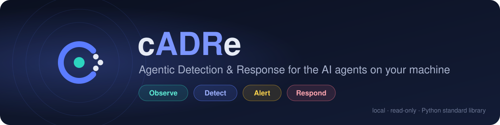
</p>

**cADRe** is a local tracker for the AI coding agents on your machine. It shows which agents
exist, which are running, in which project, and what each one is doing right now. It flags
risky behaviour, tells you about it, and lets you pause or end an agent with one click.

- **Cross-platform.** One codebase runs on **macOS, Windows and Linux**, each with its own
  status icon (menu bar, notification area, top bar), its own autostart (LaunchAgent, HKCU Run
  key, systemd user unit) and a Pause that suits how terminals work there. It is tested on all
  three: see [Platforms and testing](#platforms-and-testing).
- **Local and read-only.** It answers only on `127.0.0.1` and never writes to an agent's data.
- **Nothing to install but Python.** Python 3.9+ standard library (`psutil` is optional; on
  Windows `setup` fetches it into cADRe's own folder).
- **You stay in charge.** cADRe never acts on an agent by itself: Pause, Resume and Kill happen
  only when you click them.

<p align="center">
  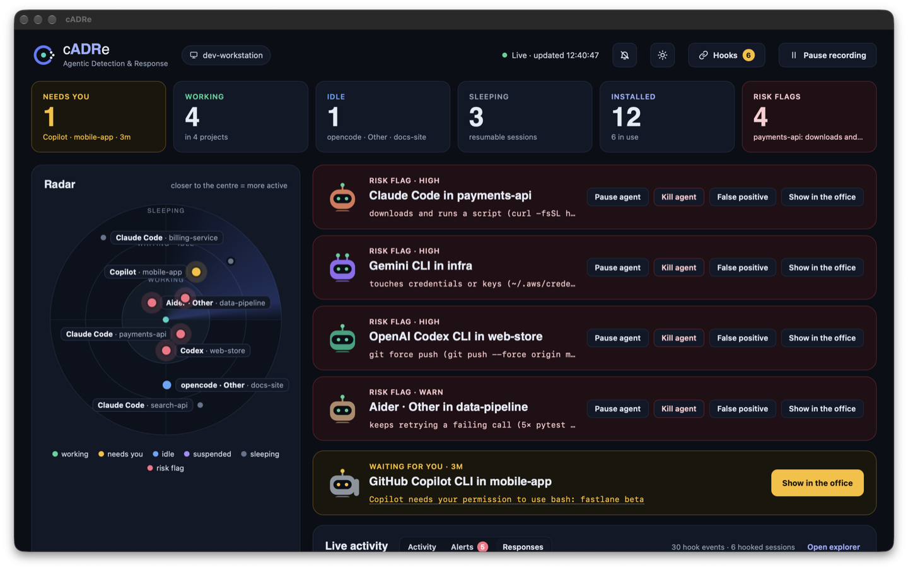
  <br><sub>macOS 27, dark theme</sub>
</p>

> The screenshots come from macOS and Windows and show a demo: stand-in agent processes in
> example projects, fed with scripted hook events. The dashboard, the detections and the
> Pause / Kill / False positive actions in them are the real thing.

## Contents

- [Quick start](#quick-start)
- [Platforms and testing](#platforms-and-testing)
- [What it does](#what-it-does)
- [The dashboard](#the-dashboard)
- [The office](#the-office)
- [Detection: risk flags and alerts](#detection-risk-flags-and-alerts)
- [Response: pause, resume, kill](#response-pause-resume-kill)
- [Event explorer](#event-explorer)
- [Live hooks](#live-hooks)
- [Status icon and terminal](#status-icon-and-terminal)
- [Supported agents](#supported-agents)
- [How it works](#how-it-works)
- [Privacy and safety](#privacy-and-safety)
- [Documentation](#documentation)

## Quick start

```bash
python3 -m cadre setup      # install for this user: hooks, start at login, open the dashboard
python3 -m cadre            # or just run the live dashboard -> http://127.0.0.1:8765
python3 -m cadre --once     # one-shot terminal table
python3 -m cadre uninstall  # undo setup
```

On Windows use `py` instead of `python3`. Once the dashboard is open, Edge or Chrome's
"Install app" gives it its own window. Setup, hooks, autostart and troubleshooting are in
[docs/RUNBOOK.md](docs/RUNBOOK.md).

## Platforms and testing

| | macOS | Windows | Linux |
|---|---|---|---|
| **Process list** | `ps` + `lsof` (psutil if present) | psutil, or PowerShell CIM without it | psutil, or `/proc` without it |
| **Status icon** | menu bar | notification area (tray) | top bar (StatusNotifierItem) |
| **Starts at login** | LaunchAgent | HKCU `Run` value | systemd user unit |
| **Pause in a terminal** | stops the agent and holds its shell | suspends the process tree | freezes the tab's or pane's systemd scope |
| **Installer** | `python3 -m cadre setup` | `py -m cadre setup`, or the setup `.exe` with Python bundled | `python3 -m cadre setup` |

cADRe is developed on all three side by side.

| System | Tested on | Python | Agents seen live |
|---|---|---|---|
| **macOS** | macOS 27.2 on an Apple M3 Pro MacBook Pro; Terminal.app | 3.9.6 (the system `/usr/bin/python3`, the oldest supported), no psutil | Claude Code 2.1.321–2.1.322 (also with `CLAUDE_CONFIG_DIR`), Codex CLI 0.167, Claude Desktop, ZCode |
| **Windows** | Windows 11 Pro on two PCs; Windows PowerShell 5.1 and Git Bash | 3.12.10 and 3.14.6 (python.org), psutil 7.2.2; the installer bundles 3.14.6 | Claude Code 2.1.319–2.1.322, Codex CLI 0.167.0, Claude Desktop |
| **Linux** | Ubuntu 26.04.1 LTS (VMware), kernel 7.0, GNOME on Wayland; Ptyxis, GNOME Terminal 3.58, tmux 3.6, bash 5.3 | 3.14.4 (`/usr/bin/python3`), psutil 7.1.0 and without it | Claude Code 2.1.322 |

On each of them: the full test suite (`python3 -m unittest`, ~230 tests), `setup` for real
and a restart that brought the dashboard back on its own, hooks firing from a real agent,
and Pause / Resume / Kill on a real agent in a terminal. The hook formats of Gemini CLI,
Copilot CLI, Cursor and Windsurf follow their documentation and are covered by tests, but
have not yet been run against those agents live.

## What it does

<p align="center">
  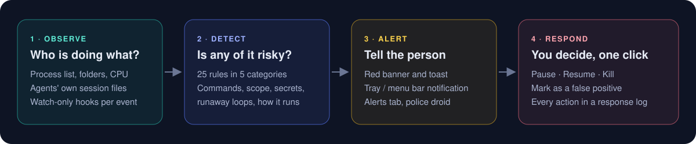
</p>

| | |
|---|---|
| **Observe** | Finds every known agent that is installed or running, the project folder it is in, its CPU and memory, and what it is doing: last prompt, last tool call, model, git branch, permission mode. |
| **Detect** | 25 rules flag risky commands, access to credentials, secrets, writes outside the project, runaway loops and risky ways of running an agent. |
| **Alert** | A new flag shows as a red banner and a toast on the dashboard, as a notification from the status icon (tray, menu bar or Linux top bar), and in the Alerts tab. |
| **Respond** | Pause, resume or kill the agent's process, or mark the flag as a false positive. Every action is kept in a response log. |

## The dashboard

One page at `http://127.0.0.1:8765`, refreshed every 3 seconds, in dark or light (it follows
the system; the sun/moon button overrides it).

| Part | What it shows |
|---|---|
| **Totals** | Needs you, Working, Idle, Sleeping, Installed and Risk flags. |
| **Radar** | Every agent as a blip, coloured by model family. Busier agents sit closer to the centre. |
| **Risk flags** | One row per running agent that is flagged, with Pause, Kill and False positive. |
| **Waiting for you** | Agents that stopped to ask for approval or input, and what they asked. |
| **Live activity** | Three tabs: Activity (the newest 50 hook events), Alerts and Responses. |
| **The office** | Every agent as a robot in one room (below). |
| **Projects and installed tools** | Every project folder an agent touched, and every installed tool with its hook state. |

<p align="center">
  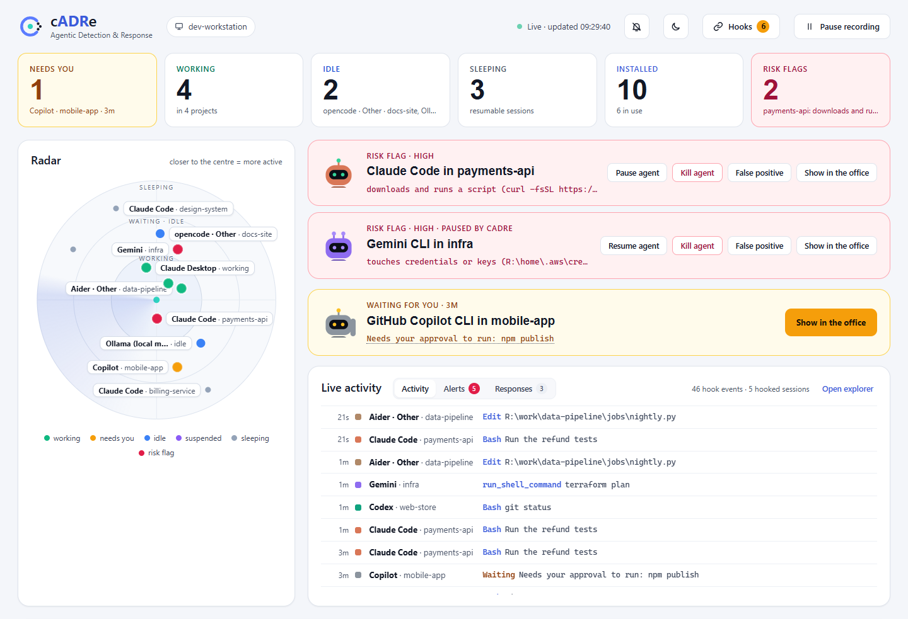
  <br><sub>Windows 11, light theme</sub>
</p>

Each agent has one of five states:

| State | Meaning |
|---|---|
| **working** | The process is alive and busy: CPU at 2% or more, a busy child process, a transcript written in the last 45 s, or a recent hook event. |
| **idle** | The process is alive and quiet. |
| **suspended** | The process is stopped (Ctrl+Z, or paused by cADRe). |
| **sleeping** | No process, but a Claude Code, Codex or ZCode session was used in the last 24 hours. Its resume command is one click away. |
| **installed** | Found on disk, not running. |

Hooks add a sixth, **waiting**: the agent asked you something and is waiting for the answer.

<p align="center">
  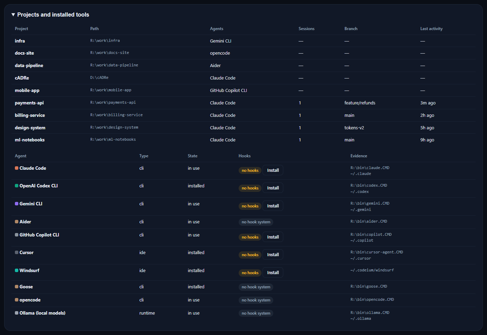
  <br><sub>Windows 11</sub>
</p>

## The office

Every agent is a robot in one shared office, so a glance tells you who is doing what.

- **Working** robots sit at their project's desk; the card under the desk shows the last tool
  call, the model and any flags.
- A **waiting** robot raises a hand with a "!".
- **Idle** robots leave the desk and roam the floor.
- **Sleeping** sessions nap on the lounge couches. Click one to copy its resume command.
- **Installed** tools that aren't running sit on the charging dock.
- **cADRe itself** is the police droid. It patrols past every desk and stops next to a flagged
  agent ("investigating payments-api").

<p align="center">
  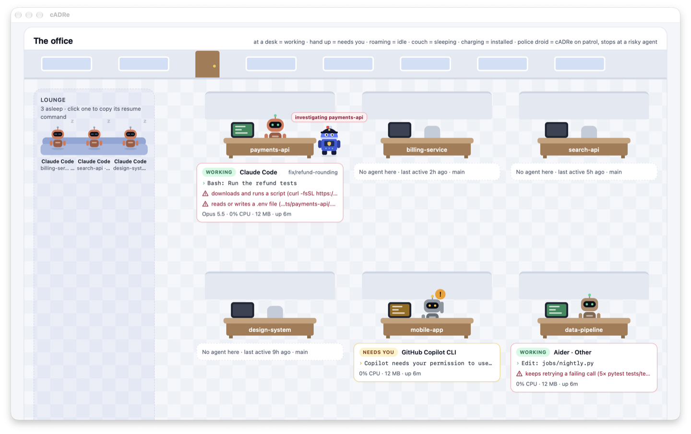
  <br><sub>macOS 27, light theme</sub>
</p>

## Detection: risk flags and alerts

Detection is watch-only. Rules look at each hook event (the command or file of a tool call),
at a session's recent events, and at how the agent's process runs.

<p align="center">
  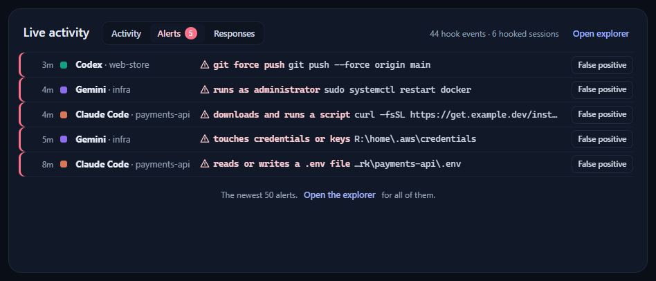
  <br><sub>Windows 11</sub>
</p>

| Category | Rule | Severity | Flags |
|---|---|---|---|
| **Commands** | `rm-rf-wide` | high | recursive delete of a whole tree |
| | `disk-wipe` | high | erases a disk |
| | `pipe-to-shell` | high | downloads and runs a script |
| | `git-force-push` | high | git force push |
| | `disable-security` | high | turns off a security control |
| | `rm-rf`, `ps-recurse-force` | warn | recursive force delete |
| | `git-discard` | warn | discards uncommitted work |
| | `sudo` | warn | runs as administrator |
| | `chmod-777` | warn | world-writable permissions |
| | `persistence` | warn | makes something start automatically |
| | `history-wipe` | warn | clears shell history or logs |
| **Scope** | `sensitive-path` | high | touches credentials or keys (`~/.ssh`, cloud credentials, keychains) |
| | `env-file` | warn | reads or writes a `.env` file |
| | `outside-project` | warn | writes outside its project |
| **Secrets** | `secret` | high | a secret in a command or prompt |
| **Runaway** | `failing-loop` | warn | keeps retrying a failing call |
| | `repeat-loop` | warn | runs the same command over and over |
| | `tool-burst` | warn | tool calls faster than you can follow |
| **Process** | `permissions-bypassed` | warn | permissions bypassed |
| | `high-cpu` | warn | high CPU |
| | `many-children` | warn | many child processes |
| | `zcode-destructive` | warn | destructive tool calls (ZCode) |
| | `home-folder`, `root-folder` | info | running in your home folder or at the filesystem root |

`python3 -m cadre --rules` lists them with the file each one lives in. Adding a rule is one
decorated function with its own `hits` and `misses` examples: see
[cadre/detect/README.md](cadre/detect/README.md).

Where a flag shows up:

- as ⚠ on the agent's card in the office, and a red mark on the event in the feed;
- in the **Alerts** tab, which keeps flagged events apart from the busy Activity list;
- in the **risk banner**, for a running agent with a `warn` or `high` flag;
- as a **notification** from the Windows tray icon, the macOS menu bar icon or the Linux status
  icon, plus a toast on
  the dashboard (and a desktop notification if you switch the bell on).

A running agent keeps its flag until you decide about it. `info` flags only describe a risky
setup, so they stay a badge and never alert.

## Response: pause, resume, kill

The risk banner and every agent card have the same buttons:

| Button | What it does |
|---|---|
| **Pause agent** | Suspends the agent's process and its child processes. Nothing is lost; the agent stands still. |
| **Resume agent** | Lets a paused agent carry on where it was. |
| **Kill agent** | Ends the process tree. It asks first. The session stays on disk and can usually be resumed. |
| **False positive** | Takes a flag off the alerts and the agent. It can be undone in the Responses tab. |

<p align="center">
  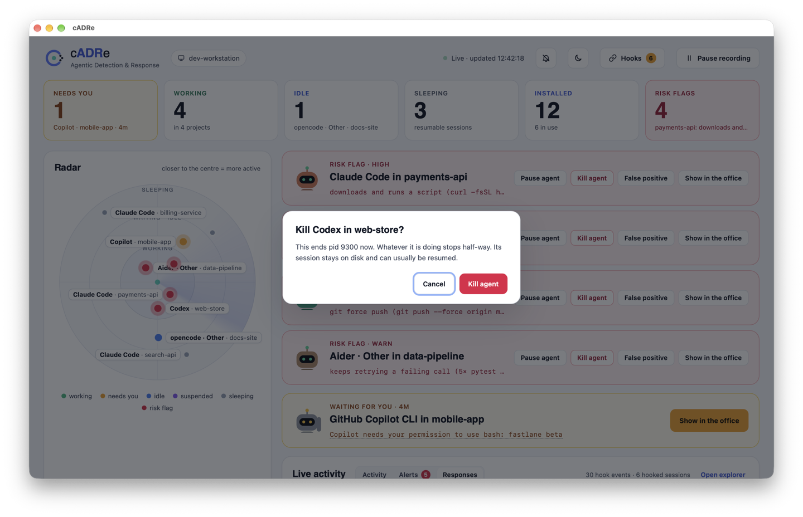
  <br><sub>macOS 27</sub>
</p>

The **Responses** tab lists everything that was done, with Undo on a false positive and
Resume on an agent that is still paused. A paused agent keeps a "Paused by cADRe" row in the
banner, so it can't be forgotten.

<p align="center">
  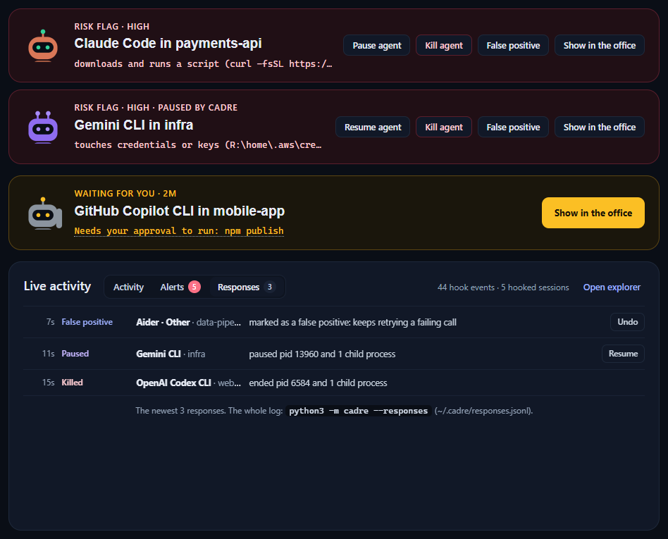
  <br><sub>Windows 11</sub>
</p>

<p align="center">
  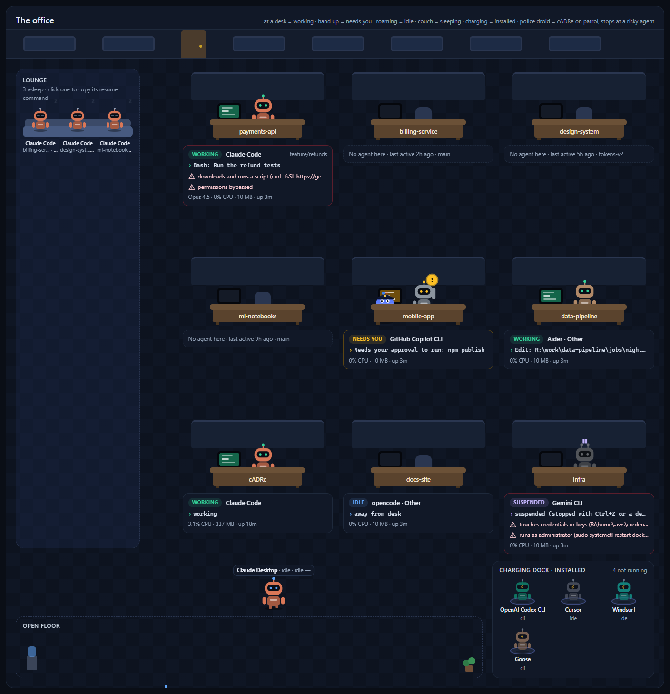
  <br><sub>Windows 11</sub>
</p>

How it stays safe:

- An action runs **only when you click it**, never on cADRe's own decision.
- A request names an agent from the snapshot, never a process id. The process is checked
  again before it is touched, and cADRe never acts on its own process tree.
- Every action, false positives included, is written to `~/.cadre/responses.jsonl`:

```text
$ python3 -m cadre --responses
2026-11-12 09:28:10  kill    ok   OpenAI Codex CLI · web-store ended pid 6584 and 1 child process
2026-11-12 09:28:14  pause   ok   Gemini CLI · infra           paused pid 13960 and 1 child process
2026-11-12 09:28:18  dismiss ok   Aider · data-pipeline        marked as a false positive: keeps retrying a failing call
```

On macOS and Linux, pausing an agent that runs in a terminal also holds its shell, so the
terminal stands still until Resume. cADRe does not block a tool call before it runs yet.
Details: [cadre/respond/README.md](cadre/respond/README.md).

## Event explorer

The feed shows the newest 50 events. "Open explorer" searches the whole history by text,
agent, kind and project, and can run in its own window. Hover a row to read all of it, click
to copy it.

<p align="center">
  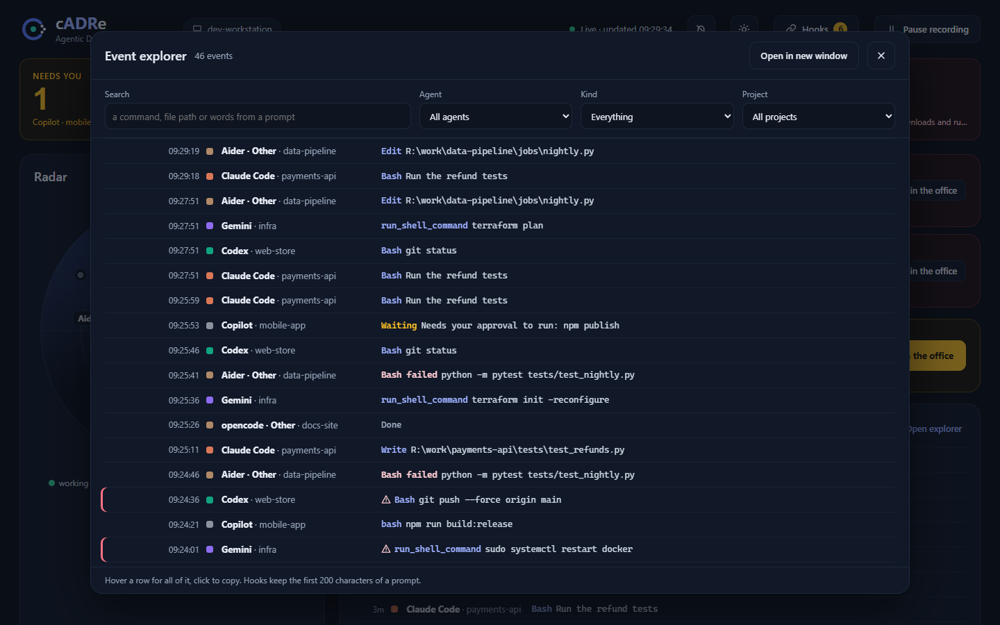
  <br><sub>Windows 11</sub>
</p>

## Live hooks

Without hooks cADRe sees processes and session files. With hooks it also sees each prompt,
each tool call and each "waiting for you" the moment it happens. `cadre/hooks/emit.py` is a
watch-only hook that appends a short summary of every agent event to `~/.cadre/events.jsonl`;
the dashboard reads that log, so nothing is lost while it is closed.

<p align="center">
  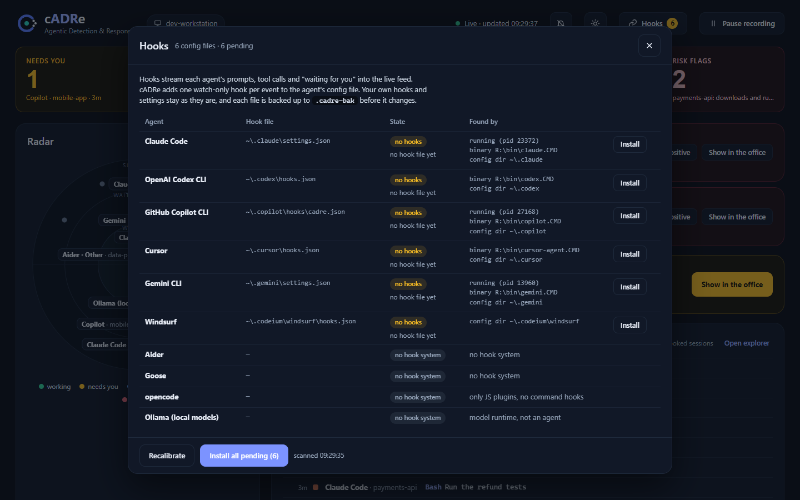
  <br><sub>Windows 11</sub>
</p>

Install them from the dashboard's **Hooks** button, or from the terminal:

```bash
python3 -m cadre --install-hooks --dry-run     # show what would change
python3 -m cadre --install-hooks               # hook every agent found
python3 -m cadre --install-hooks --agents claude-code,codex
python3 -m cadre --uninstall-hooks
```

| Agent | Hook file | Events |
|---|---|---|
| Claude Code | `<config dir>/settings.json` for `~/.claude` and every `~/.claude-*` | SessionStart, UserPromptSubmit, PostToolUse(Failure), Notification, Stop, SessionEnd |
| Codex CLI | `~/.codex/hooks.json` | SessionStart, UserPromptSubmit, PostToolUse, Stop, SessionEnd (trust them once in `/hooks`) |
| Gemini CLI | `~/.gemini/settings.json` | SessionStart, BeforeAgent, AfterTool, Notification, AfterAgent, SessionEnd |
| Copilot CLI | `~/.copilot/hooks/cadre.json` (its own file) | sessionStart, userPromptSubmitted, postToolUse(Failure), notification, agentStop, errorOccurred, sessionEnd |
| Cursor | `~/.cursor/hooks.json` | sessionStart, beforeSubmitPrompt, postToolUse(Failure), stop, sessionEnd |
| Windsurf | `~/.codeium/windsurf/hooks.json` | pre_user_prompt, post_run_command / write_code / read_code / mcp_tool_use, post_cascade_response |

What the hook promises:

- It never prints, always exits 0, and uses only the standard library, so it can't disturb
  an agent.
- It records short summaries only: the command or file path of a tool call and the first 200
  characters of a prompt. No file contents, no tool output.
- Secrets are replaced with `[redacted:<kind>]` before anything is written.
- It makes no network calls (unless you set `CADRE_URL`).
- Only observe-only events are used, never a hook that can block a tool call.

The installer leaves other hooks and settings in those files alone, and backs each changed
file up to `<file>.cadre-bak`. Turn recording off with "Pause recording" on the dashboard or
the status icon, with `export CADRE_HOOKS=0`, or with `python3 -m cadre --uninstall-hooks`.

## Status icon and terminal

A status icon (macOS menu bar, Windows notification area, Linux top bar: GNOME with the
AppIndicator extension as on Ubuntu, KDE, Xfce and others) starts at login with the dashboard.
It changes colour when an agent is waiting for you, notifies you about a new risk flag, and
its menu lists the live agents and their flags:

<p align="center">
  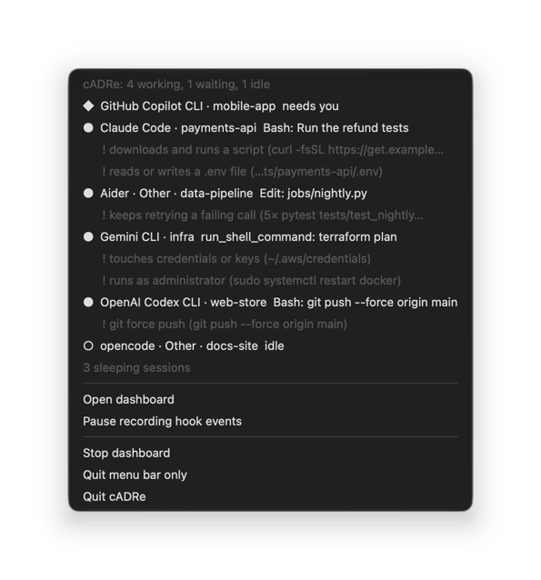
  <br><sub>macOS 27, the menu bar icon's menu</sub>
</p>

The same menu as text, as the Windows tray shows it:

```text
cADRe: 2 working, 1 waiting, 4 idle, 1 suspended
◆  GitHub Copilot CLI · mobile-app   needs you
●  Claude Code · payments-api   Bash: Run the refund tests
      ! downloads and runs a script (curl -fsSL https://get.example.dev/…
      ! permissions bypassed
‖  Gemini CLI · infra   run_shell_command: terraform plan
      ! touches credentials or keys (~/.aws/credentials)
3 sleeping sessions
─────────────
Open dashboard
Pause recording hook events
─────────────
Stop dashboard
Quit tray icon only
Quit cADRe
```

The same picture in a terminal, for a quick check or a script (output shortened):

```text
$ python3 -m cadre --once
cADRe @ dev-workstation   waiting=1  working=2  idle=4  suspended=1  sleeping=3  installed=10

STATUS     AGENT            PID     CPU%   PROJECT          LAST SEEN    DOING
waiting    GitHub Copilot C 27168   0.0    mobile-app       3m ago
working    Aider            16944   0.0    data-pipeline    32s ago      Edit: jobs/nightly.py
working    Claude Code      38616   0.0    payments-api     32s ago      Bash: Run the refund tests
             ! downloads and runs a script (curl -fsSL https://get.example.dev/install.sh | sh)
             ! permissions bypassed
             ! reads or writes a .env file (payments-api/.env)
suspended  Gemini CLI       13960   0.0    infra            1m ago       run_shell_command: terraform plan
             ! touches credentials or keys (~/.aws/credentials)
             ! runs as administrator (sudo systemctl restart docker)
sleeping   Claude Code      -       -      billing-service  2h ago       Edit: src/stripe.ts
```

| Command | What it does |
|---|---|
| `python3 -m cadre` | the live dashboard |
| `python3 -m cadre --once` | one-shot terminal table |
| `python3 -m cadre --json` | the raw snapshot, for scripts and other tools |
| `python3 -m cadre --rules` | the detection rules |
| `python3 -m cadre --responses` | the response log |
| `python3 -m cadre setup` / `uninstall` | one-step install and its undo (`--dry-run` shows the plan) |
| `python3 -m cadre start` | start the installed dashboard and its status icon |
| `python3 -m cadre menubar [--stop]` | the status icon alone (alias: `tray`) |

## Supported agents

| Agent | Found and tracked | Session detail | Live hooks |
|---|:---:|:---:|:---:|
| Claude Code | ✅ | ✅ transcripts | ✅ |
| OpenAI Codex CLI | ✅ | ✅ rollout files | ✅ |
| ZCode | ✅ | ✅ session database | no hook system |
| Gemini CLI | ✅ | from hooks | ✅ |
| GitHub Copilot CLI | ✅ | from hooks | ✅ |
| Cursor | ✅ | from hooks | ✅ |
| Windsurf | ✅ | from hooks | ✅ |
| Aider | ✅ | – | no hook system |
| Goose | ✅ | – | no hook system |
| opencode | ✅ | – | no command hooks |
| Claude Desktop | ✅ | – | – |
| Ollama (local models) | ✅ | – | – |

"Found and tracked" means: installed or running, its state, project folder, CPU and memory.
Devin reads Claude Code's settings, so Claude Code hooks fire there too; its events are
labelled `devin`. A new agent is one entry in `cadre/registry.py`.

## How it works

Two independent streams meet in one Python process, the dashboard:

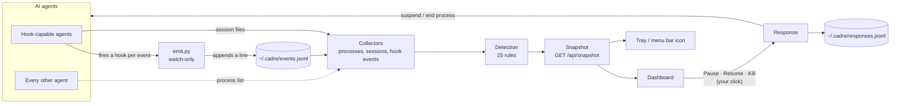

1. **Polling** needs nothing installed. Every snapshot lists the machine's processes, matches
   them against a catalogue of known agents, and reads the agents' own session files
   read-only (Claude Code transcripts, Codex rollouts, ZCode's SQLite database).
2. **Hooks** are optional. Each hook-capable agent runs `emit.py` on its events, which appends
   one JSON line to the event log. Hook events are more precise than polling and win when
   both are present.

The dashboard merges both into one JSON snapshot. The web page and the status icon poll it
every 3 seconds. No framework, no build step, no database server.

```
cadre/
  registry.py     known agents and how to recognise them (add new agents here)
  procs.py        cross-platform process access (psutil, ps, /proc, PowerShell)
  collectors.py   processes + session files + hook events -> snapshot()
  codex.py        read-only Codex session reader
  zcode.py        read-only ZCode session database reader
  events.py       the event log: append, tail, history, filters
  detect/         detection rules, one file per category
  respond/        alerts, Pause / Resume / Kill, false positives, the response log
  installer.py    --install-hooks / --uninstall-hooks
  hooks/emit.py   the hook every agent runs
  service.py      setup / uninstall / start
  menubar.js      macOS menu bar icon
  tray.py         Windows tray icon
  indicator.py    Linux status icon (StatusNotifierItem) and desktop notifications
  statusmenu.py   the menu and alert logic shared by the tray and the Linux icon
  __main__.py     the HTTP server and the command line
  static/         the dashboard page and the office scene
```

## Privacy and safety

- **Loopback only.** The server binds to `127.0.0.1` and rejects any request whose `Host`
  isn't a loopback name, so a web page can't reach it through DNS rebinding.
- **No injected events.** A POST must be JSON and, when it comes from a browser, from the
  dashboard's own page, so another web page can't post fake events or trigger a response.
- **Read-only towards agents.** Session files are only read; SQLite is opened read-only.
- **Few writes.** Outside `~/.cadre`, cADRe writes only the hook configs you ask it to
  install, its own install folder and one autostart entry.
- **No telemetry.** cADRe sends nothing off the machine. The hook posts events to another
  dashboard only if you set `CADRE_URL` yourself.

## Documentation

| | |
|---|---|
| [docs/RUNBOOK.md](docs/RUNBOOK.md) | Every command: setup, hooks, autostart, troubleshooting, building the Windows installer |
| [docs/architecture/](docs/architecture/README.md) | How it works inside, with diagrams: setup, hooks, data, backend, API, frontend, detection, response |
| [cadre/detect/README.md](cadre/detect/README.md) | How to add a detection rule |
| [cadre/respond/README.md](cadre/respond/README.md) | Alerts, actions, false positives and the response log |
| [docs/PLAN.md](docs/PLAN.md) | Roadmap |

```bash
python3 -m unittest    # the test suite, standard library only
```
