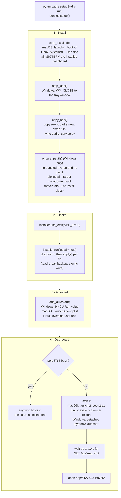
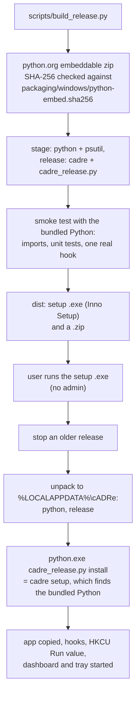
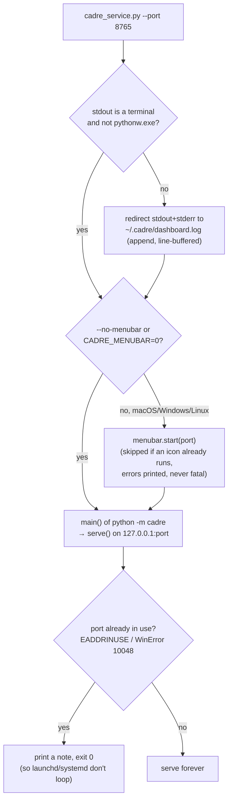
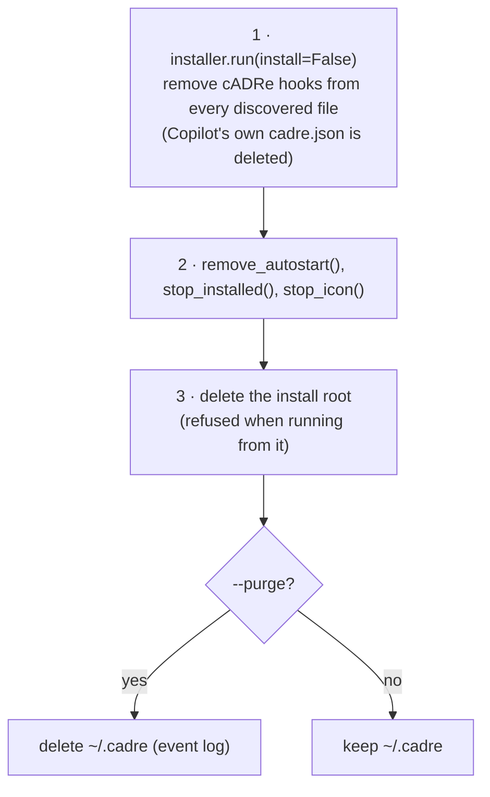

# 01 · Setup and install

**Responsible files:** `cadre/service.py` (setup, uninstall, start, autostart, launcher
code), `cadre/paths.py` (where the install folder is), `cadre/installer.py` (the hook step),
`cadre/menubar.py` (the status icon step), `cadre/__main__.py` (the `setup`/`uninstall`/`start`
subcommands); for the Windows release `scripts/build_release.py`, `packaging/windows/cadre.iss`
(the installer) and `packaging/windows/cadre_release.py` (installer → `setup` bridge).

From a checkout there is nothing to compile or package. cADRe is a standard-library Python
package; "install" means copying it to a stable per-user folder and wiring three things to
that copy: the agents' hooks, a login entry, and a running dashboard. On Windows there is also
a release installer that brings its own Python and then runs the same `setup` (see
[Windows release](#windows-release)).

## Why copy at all?

Hook commands contain an absolute path to `emit.py`. If they pointed into the git checkout,
moving, renaming or re-cloning the checkout would silently break every agent's hooks. So
`setup` copies the package to an install folder and points everything there. The checkout is
for development; the install folder is what runs.

Consequence: **after `git pull`, re-run `setup`** to ship the new code to the installed copy.
`--install-hooks` from a checkout also points hooks at the install folder once one exists
(`installer.EMIT = paths.APP_EMIT if paths.installed() else paths.PKG_EMIT`).

## Install folder

Decided by `paths.app_root()`:

| OS | Install root (`paths.ROOT`) | Package copy | Launcher |
|---|---|---|---|
| Windows | `%LOCALAPPDATA%\cADRe` (e.g. `C:\Users\me\AppData\Local\cADRe`) | `…\cADRe\app\cadre\` | `…\cADRe\app\cadre_service.py` |
| macOS | `~/Library/Application Support/cADRe` | `…/cADRe/app/cadre/` | `…/cADRe/app/cadre_service.py` |
| Linux | `$XDG_DATA_HOME/cadre` (default `~/.local/share/cadre`) | `…/cadre/app/cadre/` | `…/cadre/app/cadre_service.py` |

`paths.installed()` is true when both `app/cadre/hooks/emit.py` and `app/cadre_service.py`
exist. `paths.running_from_install()` is true when the code running *is* the installed copy
(then `setup` leaves the files alone and `uninstall` refuses to delete its own folder).

Data does **not** live here; it stays in `~/.cadre` (see [03](03-data-and-logs.md)), so
uninstalling keeps the event log unless `--purge` is given.

## `cadre setup`: step by step



Options: `--dry-run` (print every "would …", touch nothing), `--no-autostart`, `--no-start`,
`--no-browser`, `--agents claude-code,codex` (limit the hook step). `CADRE_PORT=9000` makes
the whole install use another port (it is baked into the autostart entry).

### The atomic copy

`copy_app()` never leaves a half-copied package where hooks could run it:

```
app/cadre.new   ← shutil.copytree(checkout/cadre, ignore __pycache__, *.pyc, *.cadre-bak)
app/cadre       → app/cadre.old     (os.replace, instant)
app/cadre.new   → app/cadre         (os.replace, instant)
app/cadre.old   deleted
app/cadre_service.py  ← LAUNCHER_CODE (LF line endings)
```

### Which Python runs what

A release's bundled Python (`%LOCALAPPDATA%\cADRe\python\`, see
[Windows release](#windows-release) below) always comes first. Without one:

| Role | Windows | macOS | Linux |
|---|---|---|---|
| Hooks (`installer.hook_python()`) | `python.exe` of the Python running the installer, **also when that is `pythonw.exe`** (the dashboard's Install button), with forward slashes | `/usr/bin/python3` if the Command Line Tools (or Xcode) make it real, else the Python running `setup` | `/usr/bin/python3` if it exists, else the running Python |
| Dashboard (`service.service_python()`) | `pythonw.exe` next to it (no console window) | same as the hooks | same as the hooks |
| Tray / menu bar icon | `pythonw.exe` running `tray.py` | `/usr/bin/osascript -l JavaScript menubar.js` | the running Python if it can import Gio (python3-gi), else `/usr/bin/python3`, running `indicator.py` in a `systemd-run --user --scope` |

The rule gives the same answer whoever installs (CLI, `setup`, the dashboard), so
`installer.check()` and a fresh install always agree. Hooks get the console `python.exe`
because agents start them as console programs that wait and pass the payload on stdin.

Without a bundled Python, the hook command contains the interpreter's path, so **upgrading
Python means re-running `setup`**; the Hooks dialog shows such files as `outdated`. On macOS,
`/usr/bin/python3` is a stub until the Command Line Tools are installed (running it opens
Apple's install dialog), so `setup` then uses the Python it runs with and says so.

## Windows release

A per-user installer built by `scripts/build_release.py` (Inno Setup script
`packaging/windows/cadre.iss`). It brings its own Python, so nothing has to be installed first:



| Installer step | What runs |
|---|---|
| before copying | `cadre_release.py stop` of the release already there (dashboard and tray hold its files) |
| after copying | `cadre_release.py install` → `service.setup(browser=False)`; a failure shows a message pointing at `release\setup.log`; a watchdog ends the command after 120 s (the installer waits for it without a limit) and writes every thread's stack to that log |
| Start menu "cADRe" | `pythonw.exe cadre_release.py open` → `cadre start`, then opens the dashboard |
| Uninstall (Settings → Apps) | `cadre_release.py uninstall` → `service.uninstall(files=False)` (hooks, autostart, stop), then the uninstaller deletes `app\`, `release\`, `python\` |

The embeddable Python has a `python314._pth` file (the build adds `Lib\site-packages` to it for
psutil). It pins `sys.path` and implies isolated mode, so scripts add their own folder to
`sys.path` themselves (the launcher, `tray.py`, `cadre_release.py`).

## The launcher: `cadre_service.py`

Written by `copy_app()` from `service.LAUNCHER_CODE`. It is the single thing autostart runs:



Note the `isatty()` check: on Windows, `NUL` counts as a character device, so a process
started with `stdout=DEVNULL` looks like a terminal. That is why the launcher always logs to
the file under `pythonw.exe`.

## Autostart, per OS

| OS | Entry | Content | Starts at | Restarts on crash |
|---|---|---|---|---|
| Windows | Registry value `HKCU\Software\Microsoft\Windows\CurrentVersion\Run\cADRe` | `"…\pythonw.exe" "…\cADRe\app\cadre_service.py" --port 8765` | user login | no |
| macOS | `~/Library/LaunchAgents/com.cadre.dashboard.plist` | `ProgramArguments` = python, launcher, `--port`, port; `WorkingDirectory` = app folder; `RunAtLoad` true | user login / `launchctl bootstrap` | yes: `KeepAlive` → `SuccessfulExit` false (restarts only after a non-zero exit) |
| Linux | `~/.config/systemd/user/cadre.service` (`$XDG_CONFIG_HOME` respected) | `ExecStart="python" "launcher" --port 8765`, `WorkingDirectory`, `WantedBy=default.target` | user session | yes: `Restart=on-failure` |

Actual value on this Windows machine:

```
"C:\Users\me\AppData\Local\Python\pythoncore-3.14-64\pythonw.exe" "C:\Users\me\AppData\Local\cADRe\app\cadre_service.py" --port 8765
```

None of these need admin rights. `CADRE_RUN_KEY` overrides the registry key (used by tests).

## `cadre start`

`service.start_all()`: for when the dashboard or icon was quit (e.g. "Quit cADRe" in the icon
menu). Changes no files. Starts the icon from the install folder, then the dashboard if
nothing answers on the port. Fails with a hint if cADRe isn't installed.

## `cadre uninstall [--purge] [--dry-run]`



Hooks are recognised as cADRe's by the regex `[/\\](cadre|agenttracker)[/\\]hooks[/\\]emit\.py`
(case-insensitive), so uninstall also removes entries pointing at older copies (a moved
checkout, the project's former name AgentTracker). Foreign hooks are never touched.

## What setup writes, in one list

| Where | What | Removed by `uninstall` |
|---|---|---|
| Install root (see table above) | package copy + launcher | yes |
| Install root, Windows release only | `python\` (embeddable Python + psutil), `release\` (package of the release, `cadre_release.py`, `setup.log`), the uninstaller `unins000.exe`, a Start menu entry, an entry in Settings → Apps | by the release's uninstaller |
| Each discovered agent hook file | cADRe hook entries, plus `<file>.cadre-bak` backup of the previous version | entries yes (backup stays) |
| Autostart entry (one per OS) | registry value / plist / unit file | yes |
| `~/.cadre/` | created on first event or log write | only with `--purge` |

Nothing else outside `~/.cadre` is ever written.
