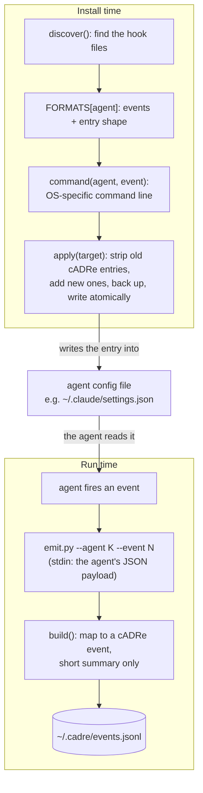
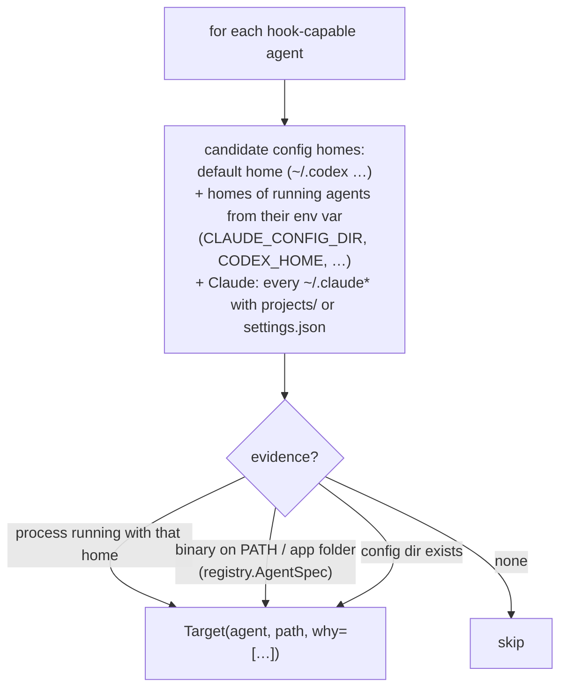
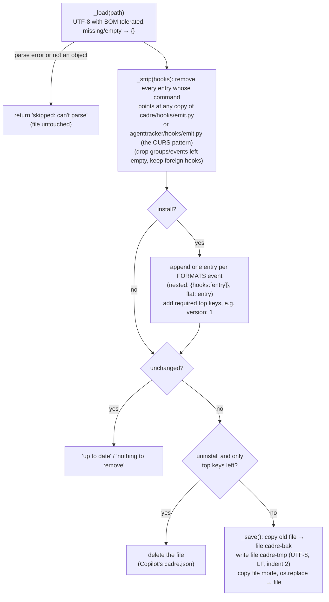
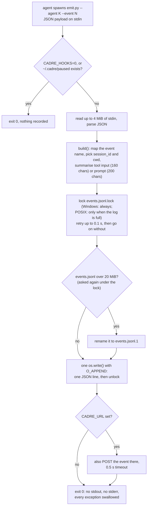

# 02 · Hooks

**Responsible files:** `cadre/installer.py` (creating, checking and removing hook entries in
agents' config files), `cadre/hooks/emit.py` (the program the agents run), `cadre/events.py`
(reading what `emit.py` wrote), `cadre/collectors.py` (`apply_hook`, `hook_coverage`: using
the events and showing coverage).

A "hook" is an entry in an agent's own config file telling the agent to run a command on some
lifecycle event (session started, prompt submitted, tool finished, waiting for the user,
turn stopped). cADRe's command is always `emit.py` with `--agent <key> --event <name>`.

## Two halves



## Supported agents and their hook files

From `installer.FILENAMES`, `default_home()`, `ENV_HOMES` and `FORMATS`:

| Agent (key) | Hook file (default) | Config-dir override env var | Layout | cADRe owns the whole file? |
|---|---|---|---|---|
| Claude Code (`claude-code`) | `~/.claude/settings.json` and every `~/.claude*/settings.json` alternate (e.g. `~/.claude-glm`) | `CLAUDE_CONFIG_DIR` | nested `{event: [{hooks: [entry]}]}` | no (shared settings) |
| Codex (`codex`) | `~/.codex/hooks.json` | `CODEX_HOME` | nested | no |
| Gemini CLI (`gemini`) | `~/.gemini/settings.json` | `GEMINI_CLI_HOME` | nested | no |
| Copilot CLI (`copilot`) | `~/.copilot/hooks/cadre.json` | `COPILOT_HOME` | flat `{event: [entry]}`, `version: 1` | **yes** (deleted on uninstall) |
| Cursor (`cursor`) | `~/.cursor/hooks.json` | – | flat, `version: 1` | no |
| Windsurf (`windsurf`) | `~/.codeium/windsurf/hooks.json` | – | flat | no |

Agents with no usable hook system (`installer.NO_HOOKS`): Claude Desktop (MCP only), ZCode
(read from its DB instead), Aider, Goose, opencode (JS plugins only), Ollama (a model runtime).
Devin needs nothing: it reads `~/.claude/settings.json`, so the Claude Code hooks fire there
too and `emit.py` relabels them.

On Windows, `~` is `%USERPROFILE%` (e.g. `C:\Users\me\.claude\settings.json`).

## Discovery: which files get hooks

`installer.discover(procs=None)` returns one `Target(agent, name, path, why)` per hook file.
A file qualifies if there is **any** evidence for its agent:



Paths are normalised (`os.path.normpath`) and de-duplicated case-insensitively so Windows
doesn't list `C:\Users\x/.claude` and `C:\Users\x\.claude` twice. Reading another process's
environment needs psutil on Windows; without it only default homes are found.

## The hook entry per agent

`installer.FORMATS` defines, per agent, the events to hook and the JSON entry for one event:

| Agent | Events hooked (the agent's own names) | Entry |
|---|---|---|
| claude-code | `SessionStart`, `UserPromptSubmit`, `PostToolUse`, `PostToolUseFailure`, `Notification`, `Stop`, `SessionEnd` | `{"type":"command","command":CMD,"async":true,"timeout":5}` |
| codex | `SessionStart`, `UserPromptSubmit`, `PostToolUse`, `Stop`, `SessionEnd` | `{"type":"command","command":CMD,"async":true,"timeout":3}` |
| gemini | `SessionStart`, `BeforeAgent`, `AfterTool`, `Notification`, `AfterAgent`, `SessionEnd` | `{"name":"cadre","type":"command","command":CMD,"timeout":3000}` (milliseconds) |
| copilot | `sessionStart`, `userPromptSubmitted`, `postToolUse`, `postToolUseFailure`, `notification`, `agentStop`, `errorOccurred`, `sessionEnd` | macOS/Linux `{"type":"command","bash":CMD,"timeoutSec":3}`; Windows `{"type":"command","timeoutSec":3,"powershell":"& " + CMD}` |
| cursor | `sessionStart`, `beforeSubmitPrompt`, `postToolUse`, `postToolUseFailure`, `stop`, `sessionEnd` | `{"command":CMD,"timeout":3}` |
| windsurf | `pre_user_prompt`, `post_run_command`, `post_write_code`, `post_read_code`, `post_mcp_tool_use`, `post_cascade_response` | `{"command":CMD,"show_output":false}` |

Never hooked: `PreToolUse`, permission requests or any other event whose hook can block or
approve. Cursor's `beforeSubmitPrompt` is the one "before" event; it can't block when the
command exits 0 with no output, which `emit.py` guarantees.

## The command line (`installer.command()`)

```
macOS / Linux (posix):
  /usr/bin/python3 -I -S '/Users/me/Library/Application Support/cADRe/app/cadre/hooks/emit.py' --agent claude-code --event Stop >/dev/null 2>&1; exit 0

Windows (plain: works in cmd, PowerShell and Git Bash):
  C:/Users/me/AppData/Local/Python/pythoncore-3.14-64/python.exe -I -S "C:/Users/me/AppData/Local/cADRe/app/cadre/hooks/emit.py" --agent claude-code --event Stop

Windows, Copilot (powershell key):
  & C:/…/python.exe -I -S "C:/…/emit.py" --agent copilot --event sessionStart
```

* `-I` (isolated: ignore `PYTHON*` env vars and the user site dir) and `-S` (no `site`
  import): fast start-up and immune to whatever Python environment the agent was launched in.
  Hence `emit.py` can't import the `cadre` package and duplicates the append logic.
* `--agent` and `--event` are always passed: Copilot's camelCase payloads have no event-name
  field, and each agent spells events differently.
* Windows paths use **forward slashes** (backslashes break under Git Bash); the Python path
  is quoted only if it contains a space; `emit.py`'s path is always quoted.
* On POSIX the shell wrapper (`>/dev/null 2>&1; exit 0`) also covers a missing interpreter.

A real entry from `C:\Users\me\.claude\settings.json`:

```json
"PostToolUse": [
  {
    "hooks": [
      {
        "type": "command",
        "command": "C:/Users/me/AppData/Local/Python/pythoncore-3.14-64/pythonw.exe -I -S \"C:/Users/me/AppData/Local/cADRe/app/cadre/hooks/emit.py\" --agent claude-code --event PostToolUse",
        "async": true,
        "timeout": 5
      }
    ]
  }
]
```

## Writing a config file safely (`installer.apply()`)



The `OURS` pattern is `[/\\](cadre|agenttracker)[/\\]hooks[/\\]emit\.py` (case-insensitive).
Strip-then-add makes the operation idempotent and also repairs stale entries (old copy of
cADRe, old Python). Every other key in the file (model, permissions, foreign hooks) is kept
as it was.

## Coverage states (`installer.check()`)

Read-only check of one file, used by the dashboard (`/api/hooks`, the Hooks dialog, the
"no hooks" badges) and `installer.scan()` (cached 30 s inside snapshots):

| State | Meaning | Fixable by Install |
|---|---|---|
| `ok` | cADRe's entry on every event, exactly as `installer` would write it now | – |
| `missing` | no cADRe hook in the file, or no file yet | yes |
| `stale` | a cADRe hook pointing at another copy of `emit.py` (moved checkout, AgentTracker) | yes |
| `outdated` | ours, but some events are missing, extra, or the command changed (e.g. a new Python) | yes |
| `unreadable` | the file doesn't parse; left alone | no (fix by hand) |

`install_paths(paths)` (the dashboard's Install / Install all pending) only writes files that
`discover()` itself returns, whatever paths the request names, so the HTTP API can't be used
to write anywhere else.

## Run time: what `emit.py` does



### Event-name mapping (`EVENT_MAP`)

Everything is mapped onto cADRe's vocabulary: `SessionStart`, `UserPromptSubmit`,
`PostToolUse`, `PostToolUseFailure`, `Notification`, `Stop`, `SessionEnd` (plus `ErrorOccurred`
and `Info`). Unmapped names just get their first letter upper-cased (`sessionStart` →
`SessionStart`).

| Agent | Agent's event | cADRe event |
|---|---|---|
| gemini | `BeforeAgent` / `AfterTool` / `AfterAgent` | `UserPromptSubmit` / `PostToolUse` / `Stop` |
| copilot | `userPromptSubmitted` / `agentStop` / `errorOccurred` | `UserPromptSubmit` / `Stop` / `ErrorOccurred` |
| copilot | `notification` with type `agent_completed`, `agent_idle` | `Stop` (finished, not waiting) |
| copilot | `notification` with type `shell_completed`, `shell_detached_completed` | `Info` |
| cursor | `beforeSubmitPrompt` / `stop` | `UserPromptSubmit` / `Stop` |
| windsurf | `pre_user_prompt` / `post_cascade_response` | `UserPromptSubmit` / `Stop` |
| windsurf | `post_run_command`, `post_write_code`, … | `PostToolUse` with tool `run_command`, `write_code`, … |
| claude-code with `DEVIN_PROJECT_DIR` set | any | same event, agent relabelled `devin` |

### Field extraction (`build()`)

| Field | Taken from (first present) |
|---|---|
| `session_id` | `session_id`, `sessionId`, `conversation_id`, `trajectory_id`, env `GEMINI_SESSION_ID`; else `"<agent>:<cwd>"` |
| `cwd` | `cwd`, `workspace_roots[0]`, `tool_info.cwd`, env `DEVIN_PROJECT_DIR`, env `GEMINI_CWD` |
| `transcript_path` | `transcript_path`, `transcriptPath` |
| `tool`, `detail` (tool events) | `tool_name`/`toolName`; detail = first of `description`, `command`, `command_line`, `file_path`, `filePath`, `path`, `notebook_path`, `pattern`, `url`, `query`, `skill`, `mcp_tool_name` from the tool input, ≤160 chars |
| `command`, `path` (tool events) | for detection: the shell command as run (`command`, `command_line`, `cmd`; line breaks kept so heredocs stay recognisable) and the file touched (`file_path`, `filePath`, `path`, `notebook_path`), ≤300 chars each |
| `detail` (prompt) | `prompt` / `tool_info.user_prompt`, ≤200 chars |
| `detail` (notification) | `message` / `title`, ≤200 chars; plus `notification_type` |
| `failed` | true for `PostToolUseFailure` and `ErrorOccurred` |

Tool output, file contents and full prompts are never recorded. Secrets in any of these fields
(API keys, tokens, private keys, `password=...`) are replaced by `[redacted:<kind>]` before the
line is written (`emit.redact()`, the same table as `cadre/detect/rules/secrets.py`).

## Switching hooks off

| Switch | Who sets it | Effect |
|---|---|---|
| `~/.cadre/paused` exists | Dashboard **Pause recording**, tray / menu bar **Pause recording hook events** (`POST /api/pause`, or the icon writes the file itself) | `emit.py` returns before reading anything; hooks stay installed |
| `CADRE_HOOKS=0` in the agent's environment | the user | same, for that agent process only |
| `--uninstall-hooks` / `uninstall` | the user | removes the entries |

## Agent-specific notes

* **Claude Code** applies newly installed hooks to sessions already running; every other agent
  needs a restart (the dashboard shows a hint).
* **Codex** ignores new or changed hooks until the user trusts them in `/hooks`. Its
  SessionStart fires together with the first prompt, not at launch.
* **Gemini** timeouts are milliseconds and its hook stdout must be JSON-only, which "no
  output" satisfies.

## Using the events (`collectors.apply_hook`)

For each live agent record, the newest event of its session (`STORE.latest(session_id)`)
sets `hooked`, `live_event`, `last_tool` and, unless the process is suspended, the status:

| Latest hook event | Status |
|---|---|
| `Notification` | `waiting` (needs you); `waiting_for` = its detail |
| `UserPromptSubmit`, `PreToolUse`, `PostToolUse`, `PostToolUseFailure`, `SubagentStart`, newer than 10 min | `working` |
| `Stop`, `SessionStart` | `idle` |

A Claude Code session started a moment ago has no transcript yet, so no session id to match.
`EventStore.fresh_session()` then takes the newest `SessionStart` of the same agent in the
same folder since the process started whose transcript doesn't exist yet.
