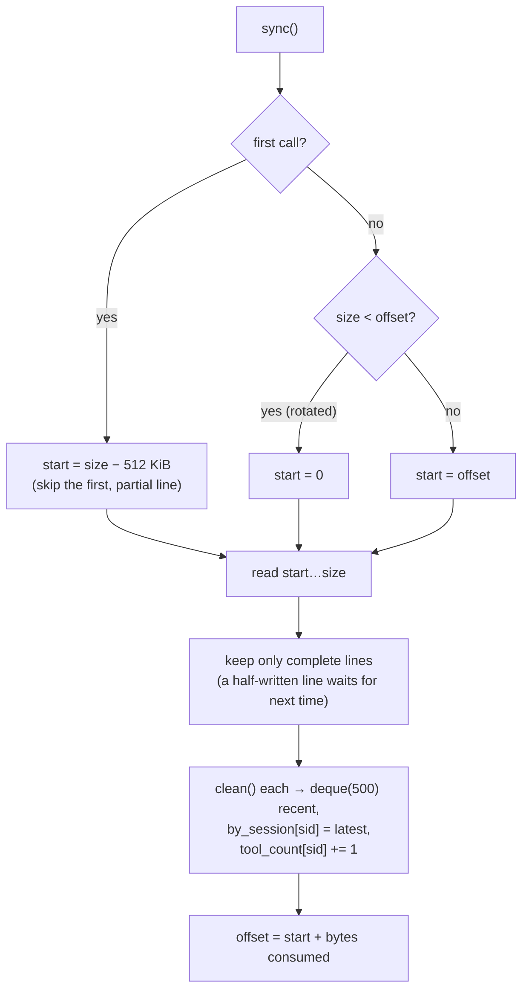

# 03 · Data and logs

**Responsible files:** `cadre/hooks/emit.py` (writes the event log), `cadre/events.py`
(reads it), `cadre/service.py` (launcher → `dashboard.log`), `cadre/tray.py` (`tray.log`),
`cadre/__main__.py` (`paused` via the API), `cadre/installer.py` (`.cadre-bak` backups).

## cADRe's own data: `~/.cadre`

| OS | Default location | Override |
|---|---|---|
| Windows | `%USERPROFILE%\.cadre` (e.g. `C:\Users\me\.cadre`) | `CADRE_HOME` |
| macOS | `/Users/<you>/.cadre` | `CADRE_HOME` |
| Linux | `/home/<you>/.cadre` | `CADRE_HOME` |

`CADRE_HOME` must be the same for the hooks and the dashboard (it is used by tests and for
scratch installs). The folder is created with mode `0700` on POSIX, files `0600`.

```
~/.cadre/
├── events.jsonl      hook events, one JSON object per line (append-only)
├── events.jsonl.1    the previous 20 MiB, after a rotation (one generation only)
├── events.jsonl.lock Windows only: empty file the writers lock for the moment of a write
├── paused            exists = hooks skip their events (content is a human note)
├── responses.jsonl   one line per Pause / Resume / Kill / false positive from the dashboard (see 10 · Response)
├── dismissed.json    the findings marked as false positives that are in force
├── dashboard.log     stdout/stderr of the dashboard started by the launcher
├── tray.log          Windows tray icon errors (pythonw has no console)
└── indicator.log     Linux status icon errors (D-Bus calls that failed, `status icon stopped: …`)
```

### `events.jsonl`: the event log

**Format:** JSON Lines, UTF-8 (`ensure_ascii=False`), `\n` line endings, one event per line.
**Writers:** `emit.py` (every hook) and `events.append()` (events POSTed to `/api/events` by
old hooks). Each line is written with a single `os.write()` on an `O_APPEND` descriptor, so
concurrent hooks never interleave partial lines.
**Windows lock:** there `O_APPEND` is a seek to the end followed by a write (the C runtime does
both), so two hooks firing together could overwrite each other. On Windows only, both writers
take a byte lock on `events.jsonl.lock` (`msvcrt.locking`, non-blocking) around the size check,
the rotation and the write. A writer that can't get the lock retries, yielding the CPU, for at
most `LOCK_WAIT` (0.1 s) and then writes anyway: one event at risk, the agent never stalls. The
lock is normally held for well under a millisecond. POSIX takes no lock for a write (appends of
this size are atomic there), but it does for a rotation (`fcntl.flock`, same cap): two writers can
see a full log at once, and without the lock the second moves the fresh log over the first one's
`.1`, losing a whole log (`_full()` asks again under the lock). `_lock`/`_unlock`/`_full` are the same code in `emit.py` and `events.py` (a test
compares them); `tests/test_log_race.py` runs 20 processes writing at once.
**Reader:** the dashboard's `EventStore`. Nothing else.

Example (a real line from this machine, pretty-printed):

```json
{
  "ts": 1794247621.096184,
  "agent": "claude-code",
  "event": "PostToolUse",
  "session_id": "0b7f3c2e-5d1a-4e8b-9c6f-2a4d8e1f3b70",
  "cwd": "C:\\Users\\me\\source\\repos\\cADRe",
  "transcript_path": "C:\\Users\\me\\.claude\\projects\\C--Users-me-source-repos-cADRe\\0b7f3c2e-5d1a-4e8b-9c6f-2a4d8e1f3b70.jsonl",
  "permission_mode": "auto",
  "tool": "Bash",
  "detail": "Read office.js and menubar.js overviews"
}
```

Fields (`events.FIELDS`; keys whose value is null are left out):

| Field | Type | Present on | Meaning |
|---|---|---|---|
| `ts` | float, epoch seconds | all | when `emit.py` ran |
| `agent` | string | all | agent key: `claude-code`, `codex`, `gemini`, `copilot`, `cursor`, `windsurf`, `devin` |
| `event` | string | all | cADRe event name (see [02](02-hooks.md#event-name-mapping-event_map)) |
| `session_id` | string | all | the agent's session id, or `"<agent>:<cwd>"` |
| `cwd` | string | most | project folder the agent reports |
| `transcript_path` | string | Claude Code, Copilot | the agent's own transcript file |
| `permission_mode` | string | Claude Code | e.g. `default`, `auto`, `bypassPermissions` |
| `tool` | string | tool events | tool name (`Bash`, `Edit`, `exec`, `run_command`, …) |
| `detail` | string | tool, prompt, notification, session, error events | short summary (≤160 tool, ≤200 prompt/notification) |
| `failed` | bool | `PostToolUseFailure`, `ErrorOccurred` | true |
| `notification_type` | string | `Notification` | the agent's notification kind, e.g. Claude Code's `idle_prompt` |

When reading, `events.clean()` keeps only these fields, caps strings at 300 characters,
fills a missing `ts`, and drops lines without `event` or `session_id`. In memory the store
also adds `received`. Feed items from ZCode's DB have the same shape plus `project` and
`source: "zcode-db"`.

**Rotation:** before appending, if `events.jsonl` is over **20 MiB** it is renamed to
`events.jsonl.1` (replacing the previous one). The same rule is implemented in both
`emit.py` and `events.append()`. On Windows it happens under the write lock, and the rename
fails while another process has the log open (the dashboard reading it): it is then simply
tried again by the next write.

**Reading (`EventStore.sync()`, before every snapshot):**



`events.history(before, limit, match)` serves the feed's scroll-back and the event explorer:
it reads `events.jsonl` then `events.jsonl.1` backwards, so all recorded history is
reachable, not just the 500 events in memory.

### `paused`

Created by `POST /api/pause {"paused": true}` (dashboard button), the Windows tray and the
macOS menu bar (they write the file themselves). Deleted to resume. `emit.py` checks
`os.path.exists` before doing anything else. The snapshot reports it as `tracker.paused`.

### `dashboard.log`

Plain text, appended, line-buffered. Whatever the dashboard and the launcher print when run
by autostart or `setup`/`start` (always under `pythonw.exe` on Windows):

```
cADRe tray icon started (the cADRe ring in the notification area; Windows 11 may put it under the ^ arrow).
cADRe dashboard: http://127.0.0.1:8765  (Ctrl+C to stop)
```

plus Python tracebacks if something crashes, and "port already in use" notes. Not rotated (it
grows by two lines per start). A dashboard run by hand (`py -m cadre`) prints to the terminal
instead.

### `tray.log`

Windows only. `YYYY-MM-DD HH:MM:SS <message>` lines for tray icon errors (e.g.
`Shell_NotifyIconW(NIM_ADD) failed`, `tray stopped: …`). The macOS menu bar logs to stdout
only when `CADRE_MENUBAR_DEBUG=1`. The Linux status icon writes the same kind of lines to
`indicator.log` (e.g. `RegisterStatusNotifierItem: …`, `Notify: …`).

## Files cADRe writes next to agent configs

| File | Written by | When |
|---|---|---|
| `<hook file>.cadre-bak` | `installer._save()` | a copy of the file as it was, before every change (overwritten each time) |
| `<hook file>.cadre-tmp` | `installer._save()` | transient: written then `os.replace`d onto the real file |

## Agent data cADRe reads (never writes)

| Source | Path | Read by | How |
|---|---|---|---|
| Claude Code transcripts | `~/.claude/projects/<encoded cwd>/<session id>.jsonl` (also `~/.claude*/projects/…`) | `collectors.read_claude_session()` | last 512 KiB only; `<encoded cwd>` = the path with every non-alphanumeric character replaced by `-` (e.g. `C--Users-me-source-repos-cADRe`) |
| Codex rollouts | `$CODEX_HOME/sessions/YYYY/MM/DD/rollout-<local time>-<id>.jsonl` (default `~/.codex`) | `codex.read_session()`, `read_meta()` | first line (`session_meta`) + last 512 KiB; cached by (mtime, size) |
| ZCode DB | `~/.zcode/cli/db/db.sqlite` | `zcode.read_sessions()`, `read_events()` | SQLite URI `file:///…?mode=ro`, 1 s timeout; tables `session`, `turn_usage`, `model_usage`, `input_history`, `tool_usage`, `part`, `message` |
| Hook configs | see [02](02-hooks.md) | `installer.check()` | parse only |
| Processes | OS | `procs.py` | psutil, `ps`, `lsof`, `/proc`, PowerShell CIM |
| Install evidence | PATH binaries, app folders, config dirs from `registry.AGENTS` | `collectors.installed_evidence()` | existence checks |

What is taken from a Claude Code transcript line: `cwd`, `gitBranch`, `permissionMode`
(type `permission-mode`), the last real user prompt (skipping meta and text starting with
`<`), the assistant's `model`, and `tool_use` blocks (name + a short description).

From a Codex rollout: `session_meta` (id, cwd, start, CLI version, git branch), `turn_context`
(cwd, model, sandbox policy → `permission_mode`, approval policy), user `response_item`
messages (prompts), `function_call` / `custom_tool_call` / `local_shell_call` /
`web_search_call` (tools), and `event_msg` `task_started` / `task_complete` / `turn_aborted`
(whether a turn is open).

## Developer-only data

| File | Purpose |
|---|---|
| `.claude/settings.local.json` | per-machine Claude Code settings, git-ignored |
