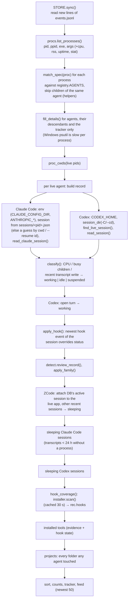
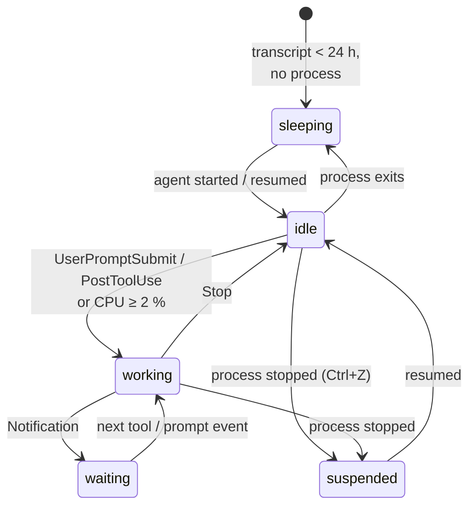

# 04 · Backend: the snapshot pipeline

**Responsible files:** `cadre/collectors.py` (`snapshot()` and everything it calls),
`cadre/registry.py` (agent catalogue), `cadre/procs.py` (processes), `cadre/events.py`
(hook events), `cadre/codex.py`, `cadre/zcode.py` (session readers), `cadre/installer.py`
(hook coverage).

The backend has one product: a **snapshot**, a JSON-serialisable dict describing every agent
on the machine right now. `collectors.snapshot()` builds it from scratch each time; the
server caches it for `--ttl` seconds (default 2) and rebuilds sooner when the event log grows.

## Pipeline



## 1. Finding agent processes

`registry.AGENTS` is a list of `AgentSpec`s. Each has:

| Field | Used for | Example (Claude Code) |
|---|---|---|
| `exe_pattern` | regex on the executable / `argv[0]` | `(^|/)claude$` or `claude.exe` not under `AnthropicClaude` / `WindowsApps\Claude_` |
| `args_pattern` | regex on the full command line, only when the exe is `node`, `bun`, `python`, `python3` or `deno` | `@anthropic-ai[\\/]claude-code[\\/]` |
| `exclude_args` | processes that aren't sessions | Codex: `[\\/]app-server-daemon[\\/]` |
| `binaries`, `apps`, `config_dirs` | "installed" evidence | `claude`, –, `~/.claude` |
| `session_source` | which deep reader to use | `claude` / `codex` |

Agents in the catalogue: Claude Code, Claude Desktop, Codex CLI, Gemini CLI, Aider, Copilot
CLI, Cursor, Windsurf, ZCode, Goose, opencode, Ollama.

`procs.py` matches on `argv[0]` (like `ps comm`) rather than psutil's `exe()`, because
`exe()` resolves symlinks (`claude` → `~/.local/share/claude/versions/2.1.x`).

### Process backends (`procs.backend()`)

| Backend | When | Gives | Missing |
|---|---|---|---|
| `psutil` | psutil importable (any OS), from this Python or, failing that, from `<install root>/site` (`procs._load_psutil()`; `setup` puts it there on Windows) | everything; cwd and env of own processes | – |
| `ps` | macOS without psutil | `ps -axo …` + `ps -axww -o pid,args`; cwd via `lsof -d cwd`; env via `ps -E` | – |
| `proc` | Linux without psutil | `ps` + `/proc/<pid>/cwd`, `/proc/<pid>/environ` | – |
| `windows-cim` | Windows without psutil | PowerShell `Get-CimInstance Win32_Process` → JSON | cwd, environment |

CPU % is computed from CPU-time deltas between calls where the OS doesn't report it (the
first sample is 0). On Windows with psutil, `status()`, `cpu_times()`, `memory_info()` and
`create_time()` are slow per process, so `list_processes()` skips them and `fill_details()`
reads them only for the pids that matter.

## 2. Status

Every agent record has one `status`:

| Status | Meaning | Decided by |
|---|---|---|
| `waiting` | needs the user (permission, question) | latest hook event `Notification`; ZCode: a tool awaiting approval |
| `working` | busy | latest hook event is a prompt/tool event < 10 min old; or CPU ≥ 2 %; or a child process ≥ 2 % CPU; or transcript written < 45 s ago; Codex: a turn started and not finished; ZCode: unanswered prompt / incomplete message / writes < 8 s |
| `idle` | running, nothing happening | none of the above; or latest hook event `Stop`/`SessionStart` |
| `suspended` | process stopped (`T` state) | process status; hooks can't override it |
| `sleeping` | no process, but a session from the last 24 h that can be resumed | transcript / rollout / ZCode session age; carries a `resume_cmd` |

Precedence: process state (`suspended`) → hook event → session-file heuristics → CPU.



## 3. Matching a process to its session

| Agent | How the live session is found |
|---|---|
| Claude Code | exact: `<home>/sessions/<pid>.json`, which Claude Code writes for each running session (`sessionId`, `cwd`, `startedAt`; ignored when older than the process, i.e. a reused pid) → `projects/*/<sessionId>.jsonl`. Without that file (older Claude Code) a guess: the `--resume <id>` file, else the newest transcript in the cwd's folder that no other process has and that was written since the process started (any age with `--continue`); without a cwd (Windows without psutil) the same from any folder, and only if it is the one such process. A wrong link puts a session's flags and Kill button on another process, so no fit = no session. Before the first prompt: `STORE.fresh_session()` (see [02](02-hooks.md#using-the-events-collectorsapply_hook)) |
| Codex | the `resume <id>` file, else the newest rollout written since the process started for its folder (`-C/--cd` or cwd) |
| ZCode | the DB's session with a running turn, else the newest |
| others | process only (plus hook events by `session_id` if hooked) |

Each transcript is claimed by one record only (`seen_transcripts`), so two sessions in the
same folder don't show the same file.

## 4. Enrichment

* **Model family** (`model_family`, `apply_family`): from the model name, endpoint
  (`ANTHROPIC_BASE_URL`) or config dir: `claude`, `glm`, `openai`, `gemini`, `qwen`, `kimi`,
  `deepseek`, `local`; else the agent's default. When the family differs from the agent's
  default, the display name becomes e.g. "Claude Code · GLM".
* **Risk flags**: `detect.review_record(rec, session events)` sets `rec.findings` (rule,
  severity, category, title, detail, ts, count) and `rec.flags` (the same as one-line texts, for
  cards, the office, the tray and the menu bar). Record rules (permissions bypassed, high CPU,
  many children, home/root folder, ZCode's destructive mark) run only for records with a
  process; every record also gets the findings of its session's events (a running agent: all of them,
  until dismissed or it ends; a sleeping session: the last hour) and
  the session rules (loops, bursts). `tracker.flagged` lists records with a `warn`/`high`
  finding: that's what the police droid visits. See [09 · Detection](09-detection.md).

* **Hook coverage** (`hook_coverage`): `rec.hooks = {state, detail, path, display, hint?}` for
  live hook-capable agents, with a hint when hooks are installed but no event has arrived
  (Codex: trust them in `/hooks`; others: restart the session).

## 5. Snapshot shape

Top-level keys of `GET /api/snapshot` / `python -m cadre --json`:

```jsonc
{
  "generated_at": 1794247630.1,     // epoch seconds
  "host": "dev-workstation",        // platform.node()
  "counts": {"working": 1, "idle": 2, "sleeping": 4, "installed": 7},
  "tracker": {                      // the dashboard process itself
    "pid": 1234, "cpu": 0.3, "rss_mb": 41.2, "uptime_s": 3600,
    "watching": 7, "events_received": 612, "hooked_sessions": 1,
    "paused": false,
    "backend": "psutil",            // procs.backend()
    "limited": null,                // a sentence when the backend can't see everything (Windows without psutil): the header chip
    "flagged": [{"id": "claude-code:5678", "name": "cADRe", "flags": ["permissions bypassed"]}]
  },
  "hooks": {                        // installer.scan()
    "targets": [{"agent": "codex", "name": "OpenAI Codex CLI", "path": "C:\\…\\hooks.json",
                 "display": "~\\.codex\\hooks.json", "why": ["config dir ~\\.codex"],
                 "state": "ok", "detail": "5 events"}],
    "emit": "~\\AppData\\Local\\cADRe\\app\\cadre\\hooks\\emit.py",
    "pending": 0,
    "unsupported": [{"agent": "zcode", "name": "ZCode", "reason": "…"}]
  },
  "alerts": [{"id": "a1794247630-1", "ts": 1794247630.1, "agent_id": "claude-code:5678",
              "agent": "Claude Code", "project": "cADRe", "rule": "rm-rf-wide", "severity": "high",
              "title": "recursive delete of a whole tree", "detail": "rm -rf ~/",
              "text": "recursive delete of a whole tree (rm -rf ~/)"}],   // findings that are new, newest first (10)
  "responses": [ /* newest 50 entries of the response log: pause, resume, kill, dismiss, restore (10) */ ],
  "dismissed": [{"who": "<session id>", "rule": "rm-rf", "detail": "rm -rf build", "ts": 1794247700.0,
                 "title": "recursive force delete", "severity": "warn",
                 "agent": "Claude Code", "project": "cADRe"}],   // false positives in force, newest first (10)
  "events": [ /* newest 50 feed events, hook log + ZCode DB */ ],
  "agents": [ /* records, sorted waiting → working → idle → suspended → sleeping */ ],
  "installed": [{"agent": "Claude Code", "agent_key": "claude-code", "kind": "cli",
                 "evidence": ["C:\\…\\claude.exe"], "active": true,
                 "hooks": {"state": "ok", "detail": "7 events", "files": 1, "paths": []},
                 "family": "claude", "family_label": "Claude", "model_label": null,
                 "display_name": "Claude Code"}],
  "projects": [{"path": "C:\\Users\\me\\source\\repos\\cADRe", "name": "cADRe",
                "agents": ["Claude Code"], "sessions": 12, "last_activity": 1794247628.8,
                "git_branch": "main"}]
}
```

An agent record (live Claude Code) has these keys:

```
id, agent, agent_key, kind, pid, cpu, rss_mb, uptime_s, args, child_count, running_children,
launched_by, cwd, project, current_dir, config_dir, endpoint, session_id, transcript,
last_activity, last_prompt, last_tool, tool_calls, git_branch, model, permission_mode,
status, waiting_for?, paused_by_cadre?, hooked, live_event, hooks, findings, flags, dismissed?,
family, family_label, model_label, display_name
```

`dismissed` holds the findings the user marked as false positives; they are no longer in
`findings` or `flags`. Events carry the same key.

`paused_by_cadre` is set (and the status is `suspended`) while an agent paused with the
dashboard's Pause button hasn't been resumed; see [10 · Response](10-response.md).

Sleeping records have `pid: null` and a `resume_cmd` such as
`cd C:\…\cADRe && claude --resume <id>` (with `CLAUDE_CONFIG_DIR=…` for alternate homes) or
`codex resume <id>`.

## 6. Cost and caching

| What | Cost control |
|---|---|
| Whole snapshot | built at most once per `--ttl` (2 s) for all clients; rebuilt early when `events.jsonl` changes size |
| Transcripts / rollouts | only the last 512 KiB read; Codex summaries cached by (mtime, size) |
| Hook coverage scan | cached 30 s; a live agent whose file wasn't in the cached scan is checked on the spot |
| Windows psutil details | only for agents, their children and the tracker |
| ZCode DB | read-only, 1 s busy timeout; any SQLite error → empty result, never a failed snapshot |
