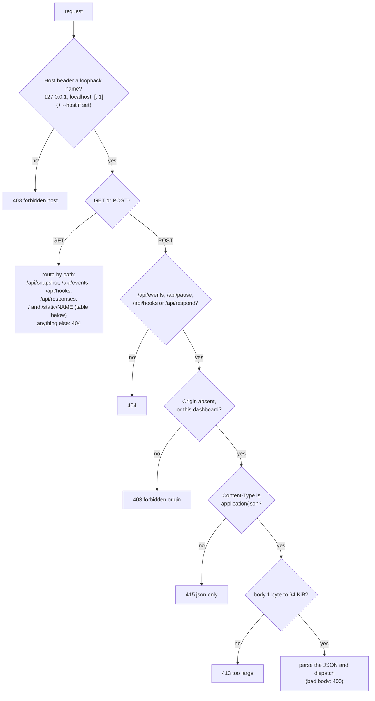
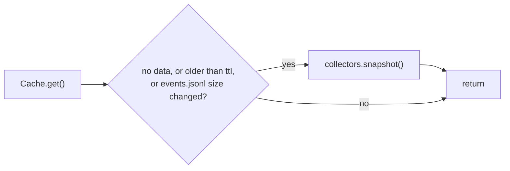

# 05 · Server and API

**Responsible file:** `cadre/__main__.py` (`serve()`, `Handler`, `Cache`, `event_history()`,
`install_hooks()`, `set_paused()`, `respond_action()`, `allowed_hosts()`, `host_ok()`,
`origin_ok()`).

The server is the standard library's `http.server.ThreadingHTTPServer` (one thread per
request). No framework, no WebSocket: clients poll.

```
python -m cadre [--host 127.0.0.1] [--port 8765] [--ttl 2.0]
```

## Request handling



All responses carry `Cache-Control: no-store` and `X-Content-Type-Options: nosniff`. Access
logging is switched off (`log_message` does nothing).

## Endpoints

### `GET /api/snapshot`

The snapshot described in [04](04-backend.md#5-snapshot-shape). Polled every 3 s by the page,
the tray icon and the menu bar icon. Served from `Cache`:



The log-size check means a hook event shows up on the next poll, not after the TTL. A
successful POST also invalidates the cache.

### `GET /api/events`

Older events for the feed's scroll-back and the event explorer, newest first.

| Query parameter | Meaning | Default |
|---|---|---|
| `before` | only events with `ts` < this (epoch seconds) | none |
| `limit` | 1–500 | 100 |
| `q` | substring over event, tool, detail, cwd, agent (case-insensitive) | – |
| `agent` | exact agent key | – |
| `kind` | `tool`, `prompt`, `waiting`, `session`, `failed` | – |
| `project` | project name (last folder of `cwd`) | – |

Response: `{"events": [...], "more": true|false}`. Hook events come from the log on disk
(both files), ZCode's from its DB (last 24 h), merged by time.

### `GET /api/hooks`

A fresh `installer.scan()` (the Hooks dialog's **Recalibrate**):
`{"targets": [...], "emit": "...", "pending": N, "unsupported": [...]}`.

### `POST /api/hooks`

The dashboard's **Install** and **Install all pending** buttons.

```jsonc
{"paths": ["C:\\Users\\me\\.codex\\hooks.json"]}   // these files
{"all": true}                                         // every file in state missing/stale/outdated
{"all": true, "dry_run": true}                        // report only
```

Response: `{"results": [{"path", "agent", "name", "result"}], "notes": [...]}`. Only files
that `installer.discover()` finds are written, whatever `paths` says.

### `POST /api/pause`

`{"paused": true}` creates `~/.cadre/paused`, `{"paused": false}` removes it. `204` on success.

### `POST /api/respond`

The Pause / Resume / Kill buttons ([10 · Response](10-response.md)).
`{"id": "<agent id from the snapshot>", "action": "pause" | "resume" | "kill", "confirm": true}`
(`confirm` is required for `kill`). `200` with the response-log entry: `ok` says whether it
worked, `result` is one sentence either way ("paused pid 500 and 2 child processes", "process
500 is already gone"). `400` with `{"error": "…"}` for a request that names no agent in the
snapshot, an agent without a process, an unknown action, or a kill without `confirm`; those
do nothing and aren't logged.

The same endpoint marks a finding as a false positive or takes that back:
`{"action": "dismiss" | "restore", "who": "<session id or agent id>", "rule": "<rule id>",
"detail": "<the finding's detail>"}` (`agent` and `project` may be added as labels for the
log). `200` with the log entry; `ok` is false when nothing changed (already marked, or not
marked). `400` for an unknown rule or a missing `who`.

### `GET /api/responses`

`{"responses": [...]}`: the last 200 entries of `~/.cadre/responses.jsonl`, newest first. The
snapshot carries the newest 50 as `responses`.

### `POST /api/events`

Kept for older hooks that POSTed instead of appending. The body (one event) is cleaned and
appended to `events.jsonl` like any other event. `204` if accepted, `400` if not an event.
New hooks only POST when `CADRE_URL` is set (to send events to a dashboard elsewhere).

### Static files

| Path | File | Type |
|---|---|---|
| `/`, `/index.html` | `cadre/static/index.html` | `text/html` |
| `/static/office.js` | `cadre/static/office.js` | `text/javascript` |
| `/static/*.png` | icons | `image/png` |
| `/static/icon.svg` | icon | `image/svg+xml` |
| `/static/manifest.webmanifest` | PWA manifest | `application/manifest+json` |

The static folder is flat: only `os.path.basename()` of the path is used, so `..` or
subpaths can't escape it. `.ico` files aren't served (only the tray uses them, from disk).

## Security model

| Threat | Defence |
|---|---|
| Another machine on the network | binds to `127.0.0.1` by default |
| DNS rebinding (a web page whose hostname is re-pointed at 127.0.0.1 reading `/api/snapshot`, which contains prompts and paths) | `Host` header must be a loopback name; 403 otherwise |
| A web page POSTing fake events, pausing hooks or triggering installs | POST requires `Content-Type: application/json`, which browsers can't send cross-origin without a CORS preflight, which the server never answers; 415 otherwise |
| The same, if a browser ever sent JSON cross-origin (added with `/api/respond`, checked on every POST) | an `Origin` header must name a loopback host; 403 otherwise. No `Origin` = not a browser (hooks, the tray, curl) |
| Pausing or ending some other process through `/api/respond` | the request names an agent id from the snapshot, never a pid; the process is checked again before it is touched; cADRe never acts on itself; kill needs `confirm` |
| Large bodies | 64 KiB limit; 413 |
| Writing arbitrary files via `/api/hooks` | only files from `installer.discover()` |
| Path traversal on `/static/` | basename only, extension allow-list |

## Clients

| Client | Calls | Every |
|---|---|---|
| `static/index.html` | `GET /api/snapshot`; `GET /api/events` (scroll / explorer); `GET`/`POST /api/hooks`; `POST /api/pause`; `POST /api/respond` | 3 s |
| `menubar.js` (macOS) | `GET /api/snapshot` (`NSURLSession`, 5 s timeout) | 3 s |
| `tray.py` (Windows) | `GET /api/snapshot` (`urllib`) | 3 s |
| `indicator.py` (Linux) | `GET /api/snapshot` (`urllib`) | 3 s |
| `service.py` | `GET /api/snapshot` to see whether a dashboard answers and get its pid | during `setup`/`start` |
| `emit.py` | `POST` to `CADRE_URL` only if set | per event |
