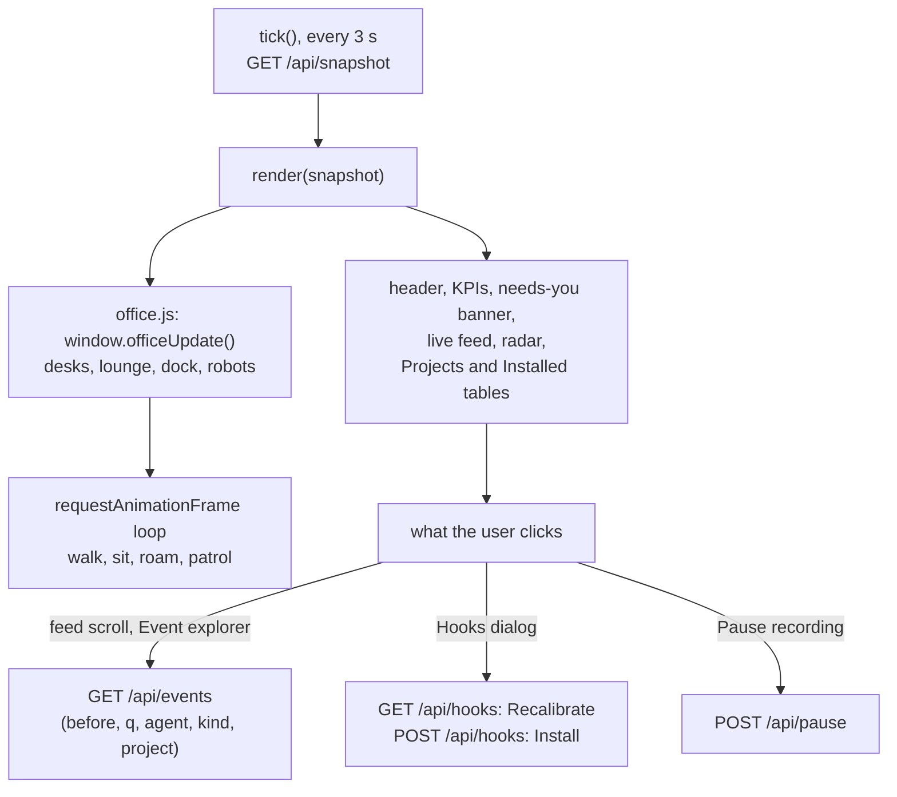
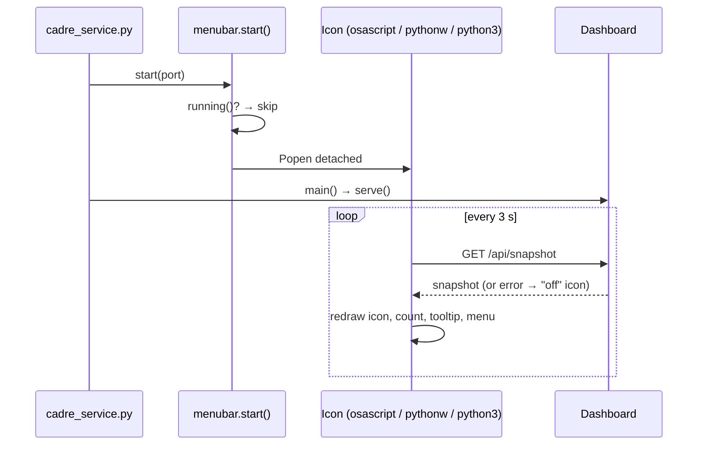

# 06 · Frontend

**Responsible files:** `cadre/static/index.html` (the page: HTML, CSS and JS inline),
`cadre/static/office.js` (the office scene), `cadre/static/manifest.webmanifest` and icons;
the status icons `cadre/menubar.js` (macOS), `cadre/tray.py` (Windows) and `cadre/indicator.py`
(Linux), started by
`cadre/menubar.py`.

No framework, no bundler, no build: plain HTML, CSS and JavaScript served as files.

## The dashboard page



### Sections, top to bottom

| Section | Element ids | Shows |
|---|---|---|
| Header | `host`, `live`, `notify`, `theme`, `hooks-btn`, `pause` | machine name; "Live · updated …" / "Recording paused" / "dashboard offline · retrying"; bell (desktop notifications for new risk flags, off until clicked, remembered in `localStorage`); theme toggle; Hooks button with a pending count; pause toggle |
| KPIs | `kpis` | six tiles: Needs you, Working (in N projects), Idle, Sleeping, Installed (N in use), Risk flags |
| Radar | `radar`, `blips` | each agent as a blip, coloured by model family |
| Risk flag | `risk` | the agent with a `warn`/`high` finding (running first, then `high`), its first flag, Pause / Resume / Kill, False positive (for the flag shown) and "Show in the office"; redrawn only when its content changes |
| Needs you | `needs` | agents in `waiting`, with what they wait for |
| Live activity | `events`, `feed-scroll`, `feed-new`, `tab-all`, `tab-alerts`, `tab-responses` | three tabs: Activity (newest 50 events), Alerts (newest 50 flagged events, seeded from `/api/events?kind=flagged`, kept apart so an alert outlives the Activity list; the count is the last hour's; each row has a False positive button for all of its findings) and Responses (`drawResponses()`: the snapshot's `responses`, with Undo on a false positive still in force); a "new" pill when you're scrolled away; the tab is remembered in `localStorage`. When the snapshot's `dismissed` changes, `resetFeed()` drops the rows held and they are read again |
| Office | `floor`, `desks`, `lounge`, `dock`, `bots` | the animated scene (below) |
| Tables | `projects`, `installed` | every project folder any agent touched; installed tools with evidence and hook state (+ Install button) |
| Kill confirmation | `confirm-dlg` dialog | names the agent, its pid and child count; Cancel has the focus |
| Event explorer | `explorer` dialog | full history with filters; "Open in new window" opens `/#explorer` standalone |
| Hooks | `hooks-dlg` dialog | every hook file, its state, Install per row, Recalibrate, Install all pending |

Agent cards (`agentCard()`) show name, model, project, status, last prompt / tool, flags, a
"no hooks" badge with an Install button, and for sleeping sessions the resume command (click
to copy). A card of an agent with a process ends in `actRow()`: Pause agent (or Resume agent
when suspended) and Kill agent, sent by `respondTo()` to `POST /api/respond`
([10 · Response](10-response.md)). Each flag chip on a card has a ✕ that marks it as a false
positive (`markFP()`), and the card says how many are marked. `renderAlerts()` turns the snapshot's `alerts` newer than
the page into a toast and, with the bell on, a `Notification`.

### Shared helpers: `window.cadre`

`index.html` exposes its helpers so `office.js` can reuse them without a module system:
`esc`, `short`, `ago`, `agoShort`, `dur`, `hash`, `famColor`, `nameOf`, `statusLabel`, `shade`,
`botSVG`, `copSVG`, `agentCard`, `WARN`, `FAMILY`, `toast`, `copyText`. `office.js` exposes
`window.officeUpdate(snapshot)` and `window.officeFocus(id)` back.

### Theme

Light/dark from `prefers-color-scheme`, overridable with the theme button; the choice is
kept in `localStorage["theme"]` and applied in an inline script before first paint. Colours
are CSS variables, which `office.js` also uses.

### Installable app

`manifest.webmanifest` (`display: standalone`, icons 192/512/SVG) lets Edge/Chrome's
"Install app" turn the dashboard into its own window with a taskbar/dock icon.

## The office scene (`office.js`)

Every agent is a robot in one shared office, built from DOM elements (not a canvas) so names
and actions are real text that never overlaps the scene.

| Agent state | Where its robot is |
|---|---|
| working | at its project's desk, screen scrolling, bobbing as it types |
| waiting | at its desk with a hand up and a "!" |
| idle | leaves the desk and roams the free floor |
| suspended | frozen where it stands, greyed, pause mark |
| sleeping | on a lounge couch (click copies the resume command) |
| installed, not running | on a charging pad in the dock |
| cADRe itself | a police droid that patrols past the desks and stops next to any flagged agent |

Desks: one per project folder used in the last 7 days, plus every folder a live agent is in;
CLI agents without a folder share a "Lobby" desk; GUI apps and model runtimes get no desk
(their working dir means nothing) and roam.

Layering: `.floor` is the stacking context; cubicle/monitor/chair at z 1, robots at z 2, desk
top/front at z 3 (so seated robots sit behind the desk). Nothing between `.floor` and those
pieces may create a stacking context.

## Status icons

All three are **viewers only**: they poll `/api/snapshot` every 3 s and never touch agents. The
same menu on all three (Windows and Linux build it with `cadre/statusmenu.py`, macOS with the
same rules in JavaScript):

```
<status line: counts, or "dashboard not running">          (disabled)
●  Claude Code · cADRe   Bash: Read the code             one row per live agent (≤ 12),
      ! permissions bypassed                              up to 2 flags each; click = dashboard
3 sleeping sessions                                       (disabled)
─────────────
Open dashboard
Pause recording hook events  /  Resume recording hook events
─────────────
Stop dashboard  /  Start dashboard
Quit tray icon only  (macOS: Quit menu bar only; Linux: Quit status icon only)
Quit cADRe                                                stops the dashboard, then the icon
```

Glyphs: `●` working, `◆` waiting, `○` idle, `‖` suspended.

| | macOS menu bar | Windows tray | Linux status icon |
|---|---|---|---|
| File | `cadre/menubar.js` | `cadre/tray.py` | `cadre/indicator.py` |
| Runs as | `/usr/bin/osascript -l JavaScript menubar.js <port>` (JXA, real AppKit `NSStatusItem`) | `pythonw.exe tray.py --port <port>` (ctypes `Shell_NotifyIconW`, hidden top-level window class `cADReTray`) | `python3 indicator.py --port <port>` (Gio from python3-gi: a StatusNotifierItem at `/StatusNotifierItem` and a `com.canonical.dbusmenu` menu at `/MenuBar`, bus name `org.kde.StatusNotifierItem-<pid>-1`), in a `systemd-run --user --scope` of its own |
| HTTP | `NSURLSession` on the main queue | `urllib` in a poller thread, posts `WM_APP+2` to refresh | `urllib` in a poller thread, `GLib.idle_add` to refresh |
| Icon: watching | `static/menubar.png` (template image: follows light/dark bar) | `static/tray.ico` (blue ring) | `static/indicator-{24,48}.png` (blue ring), sent as ARGB pixmaps |
| Icon: someone waiting | `static/menubar-waiting.png` (amber) | `static/tray-waiting.ico` (amber) | `static/indicator-waiting-*.png` (amber) |
| Icon: down or paused | `static/menubar-off.png` (dimmed) | `static/tray-off.ico` (grey) | `static/indicator-off-*.png` (grey) |
| Pause | writes / deletes `~/.cadre/paused` itself | same | same |
| Start dashboard | `launchctl kickstart` the LaunchAgent (or `bootstrap` it) | `service.start()` of the installed copy, else `pythonw -m cadre` | `service.start()` (the systemd unit), else `python3 -m cadre` |
| Stop dashboard | `launchctl bootout` the LaunchAgent | SIGTERM (TerminateProcess) the pid from the last snapshot | SIGTERM the pid from the last snapshot (systemd counts it as a clean exit, no restart) |
| New alert | `osascript` `display notification` (shown under Script Editor) | balloon (`Shell_NotifyIconW`), click opens the dashboard | `org.freedesktop.Notifications.Notify`, click opens the dashboard |
| Errors | stdout with `CADRE_MENUBAR_DEBUG=1` | `~/.cadre/tray.log` | `~/.cadre/indicator.log` |
| Debug run | `CADRE_MENUBAR_DEBUG=1 osascript -l JavaScript cadre/menubar.js` | `py cadre\tray.py --debug` | `python3 cadre/indicator.py --debug` |

On Linux the icon shows where a StatusNotifierWatcher runs: GNOME with the AppIndicator
extension (on by default in Ubuntu; GNOME turns it off on the lock screen, so the watcher
leaves and comes back, and the icon registers again each time it appears), KDE Plasma, Xfce,
Cinnamon, MATE, waybar. Without a watcher the notifications still come. Started by the
systemd unit at login, it has the session bus but not `DISPLAY` / `WAYLAND_DISPLAY`, so before
`xdg-open` it takes those from the systemd user manager's environment. With neither a watcher
nor a notification server after 5 minutes (a headless box) it quits. Without python3-gi there
is no icon (`cadre menubar` says what to install); the dashboard is unaffected.

`cadre/menubar.py` starts and stops either one (`cadre menubar` / `cadre tray`, `--stop`),
finds running icons by their command line, and on Windows quits via `WM_CLOSE` so the icon
leaves the tray at once (a killed process leaves a ghost icon). On Linux it picks a Python that
can import Gio (the running one, else `/usr/bin/python3`, e.g. when cADRe runs from a venv) and
puts the icon in a systemd scope: in the dashboard unit's cgroup, stopping the dashboard would
end the icon too, and in a terminal's scope closing the terminal would. The installed launcher starts
the icon before the dashboard, so one autostart entry brings up both.


