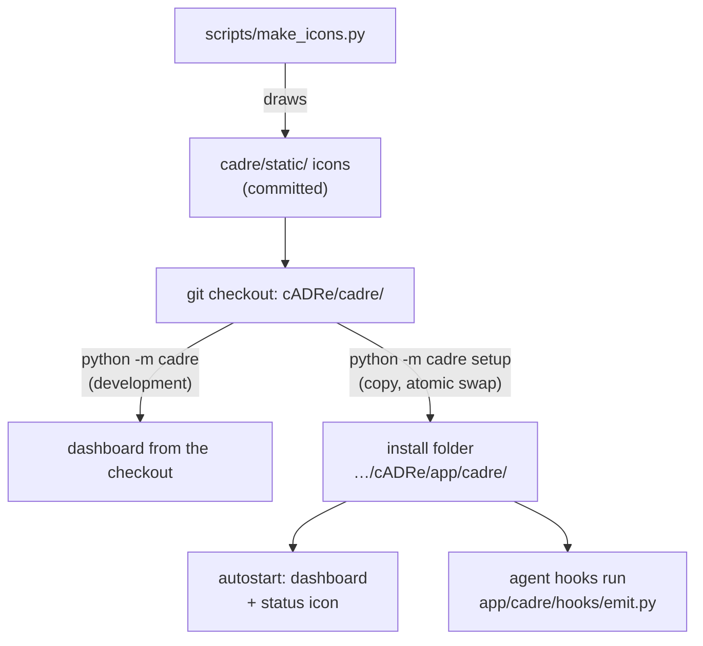

# 07 · Build, tooling and tests

**Responsible files:** `scripts/make_icons.py`, `scripts/build_release.py`,
`packaging/windows/`, `tests/`.

## No build to run it

cADRe is a pure standard-library Python package (3.9+) plus static HTML/JS. Nothing is
compiled, bundled or transpiled to run it: from a checkout, `cadre setup` copies the `cadre/`
folder to the install folder ([01](01-setup-and-install.md)). The only build is the optional
Windows release below, which wraps that same package with its own Python.



Optional dependency: `psutil` (`py -m pip install psutil`), recommended on Windows for cwd
and environment of processes. Detected at import time; every feature has a fallback.

## Windows release: `scripts/build_release.py`

```
winget install JRSoftware.InnoSetup     # once
py scripts\build_release.py             # dist\cADRe-<v>-windows-x64-setup.exe + .zip
py scripts\build_release.py --no-installer --python 3.14.6 --psutil 7.2.2
```

| Step | Detail |
|---|---|
| 1. embeddable Python | `python-<ver>-embed-amd64.zip` from python.org, cached in `build/cache/`; refused unless its SHA-256 is in `packaging/windows/python-embed.sha256` (compare with python.org's release page before adding a version) |
| 2. stage `python/` | unzip, add `Lib\site-packages` to `python3XX._pth` |
| 3. psutil | `pip install --target … --only-binary=:all: --platform win_amd64` for that Python |
| 4. stage `release/` | the `cadre` package (no `__pycache__`) + `packaging/windows/cadre_release.py` |
| 5. smoke test | with the bundled `python.exe`: imports (psutil backend), the whole unit test suite, one real `emit.py -I -S` hook call (one event, no output, exit 0) |
| 6. zip | `dist/cADRe-<v>-windows-x64.zip` (the stage) |
| 7. installer | `ISCC.exe packaging/windows/cadre.iss` → `dist/cADRe-<v>-windows-x64-setup.exe` |

Version: `__version__` in `cadre/__init__.py` (`python -m cadre --version`). `build/` and
`dist/` are git-ignored. What the installer does on the user's machine is described in
[01 · Windows release](01-setup-and-install.md#windows-release). macOS has no release package
by decision (see `docs/PLAN.md`, "Releases and platforms").

## `scripts/make_icons.py`

Draws every icon from one geometry ("Formation": the c of cADRe as a scope ring, a teal
sensor at the centre, three agents at its open edge, on a dark rounded tile), with its own
stdlib PNG/ICO encoder and supersampling. Outputs to `cadre/static/`:

| File | Use |
|---|---|
| `icon.svg`, `icon-192.png`, `icon-512.png` | browser tab, PWA / installed app |
| `tray.ico`, `tray-waiting.ico`, `tray-off.ico` | Windows tray (16–64 px; small sizes drop the three agents) |
| `menubar.png`, `menubar-waiting.png`, `menubar-off.png` | macOS menu bar (36 px shown at 18 pt; the plain one is a template image) |

```
python3 scripts/make_icons.py      # Windows: py scripts\make_icons.py
```

Re-running on another OS can produce different PNG bytes with identical pixels (zlib
differs between builds): don't commit that churn unless the design changed.

## Tests

stdlib `unittest` only, ~2 s (~6 s on Windows, where the log race tests start 40 processes), never touches real configs or `~/.cadre` (fake `HOME`,
`CADRE_HOME`, temp dirs).

```
python3 -m unittest          # Windows: py -m unittest
python3 -m compileall -q cadre
```

| File | Covers |
|---|---|
| `tests/test_installer.py` | foreign hooks and keys kept, backups, idempotent install, byte-identical uninstall, stale paths repointed, unparsable/BOM/empty files, UTF-8 + LF output, file mode, Copilot own file, Cursor flat format, Gemini ms timeout, no blocking events, POSIX and Windows command lines, `OURS` regex, `discover()`, `check()` states, `install_paths()` |
| `tests/test_emit.py` | event mapping for every agent, Devin relabel, summary length, no tool output; runs `emit.py` as `python -I -S` with junk stdin, no args, `CADRE_HOOKS=0`, paused, unreachable `CADRE_URL`, unwritable log: always exit 0, no output |
| `tests/test_detection.py` | `match_spec` (Claude Code vs Desktop/MSIX, node-launched CLIs, Codex daemon), `expand`, `parse_windows`, `_etime_to_secs` |
| `tests/test_events.py` | `clean`, `EventStore.sync` (half-written lines, rotation), `add`, `history` paging, `matcher` |
| `tests/test_log_race.py` | 20 processes appending at once through both append functions, with and without a rotation: no line lost or damaged; a held lock delays a write by the cap only (Windows); the two copies of the lock code are identical |
| `tests/test_codex.py` | synthetic rollout parsing, `find_live_session`, `describe_tool`, `-C`/`resume` |
| `tests/test_server.py` | `host_ok` (loopback names only), `POST /api/hooks` body validation (`paths` / `all`) |

Tests that depend on the OS use `installer.IS_WIN` / `installer.EMIT_CMD` rather than native
paths (the POSIX file-mode test is skipped on Windows).

## Smoke checks against the real machine

```
python3 -m cadre --once                         # terminal table
python3 -m cadre --json                         # raw snapshot
python3 -m cadre --install-hooks --dry-run      # what the installer would change
python3 -m cadre setup --dry-run
python3 -c "from cadre.procs import backend; print(backend())"
```

Browser checks without a screen: drive headless Edge/Chrome over the DevTools protocol in
real time (`--virtual-time-budget` barely runs `requestAnimationFrame`, so the office looks
stuck).
