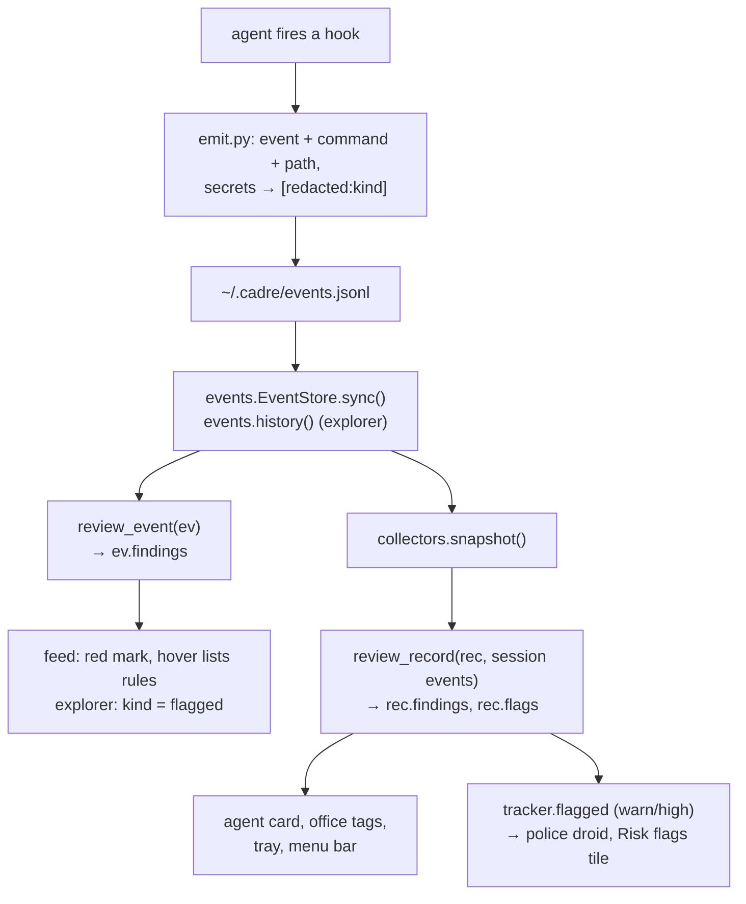

# 09 · Detection

`cadre/detect/` flags risky agent behaviour. It is **watch-only**: findings are shown, nothing
is blocked. How to add a rule, with an example, is in [`cadre/detect/README.md`](../../cadre/detect/README.md);
`python3 -m cadre --rules` lists every rule and the file it lives in.

## Layout

| File | Job |
|---|---|
| `detect/__init__.py` | Public API; importing it registers every rule |
| `detect/engine.py` | `Rule`, registry, `@event_rule` / `@session_rule` / `@record_rule`, `check_*()` |
| `detect/helpers.py` | Command and path of an event, `strip_heredocs()`, path tests, `command_patterns()` (regex tables) |
| `detect/review.py` | The only entry points the rest of cADRe uses: `review_event()`, `review_record()`, `alerting()` |
| `detect/rules/commands.py` | Dangerous shell commands (regex table) |
| `detect/rules/scope.py` | Credentials and keys, `.env` files, writes outside the project |
| `detect/rules/secrets.py` | Keys, tokens, passwords in commands or prompts |
| `detect/rules/runaway.py` | Failing loops, repeated commands, tool-call bursts (per session) |
| `detect/rules/process.py` | Permissions bypassed, CPU, child processes, home/root folder, ZCode destructive |

The engine and rules import nothing from the rest of cADRe (a test enforces it).

## Data flow

Findings are computed when events are read, never stored: changing a rule changes what old
events show. ZCode's events (from its DB) are reviewed the same way in the snapshot.

## Kinds and severities

* **event** rules see one event (`tool`, `command`, `path`, `detail`, `cwd`, `failed`);
  **session** rules a session's events of the last hour, oldest first; **record** rules a
  live agent record (`args`, `cpu`, `child_count`, `cwd`, `kind`, `permission_mode`).
* **info**: a risky setup (home or root folder), shown on the agent only. **warn**, **high**: the
  tracker's business (police droid, Risk flags tile, feed mark). High sorts first on cards.

## Limits (as of 2026-11-10)

* Only what hooks and ZCode's DB report: agents without hooks get process rules only.
* Hook events before 2026-11-10 have no `command`/`path` field; for Claude Code their
  `detail` is Bash's description, so shell rules can't see them.
* Commands are capped at 300 characters by emit.py, so a pattern after that is missed.
* No blocking. What is done with a finding (alerts, Pause / Resume / Kill by hand) is
  `cadre/respond`, see [10 · Response](10-response.md); automatic responses come later.
