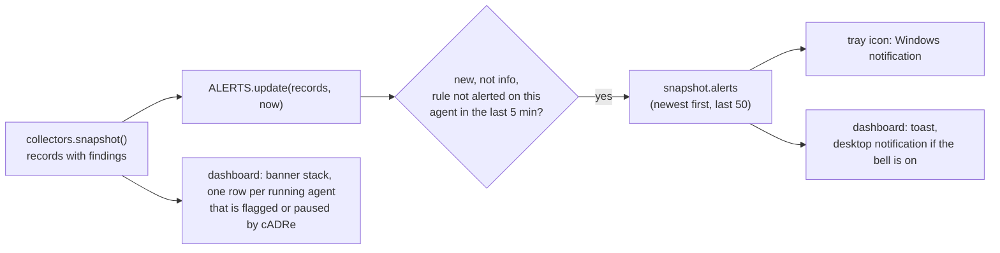
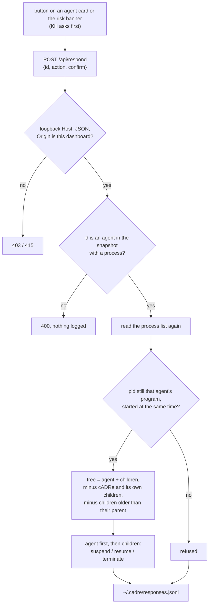
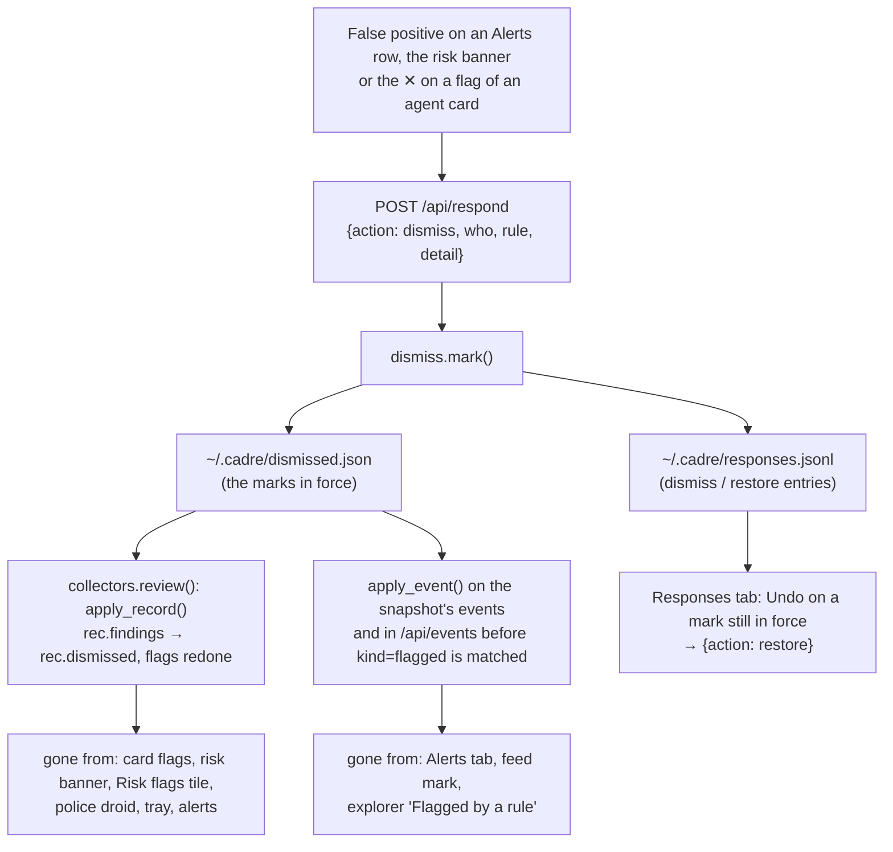

# 10 · Response

`cadre/respond/` is what cADRe does about a finding. As of 2026-11-11 that is three things:
**alerts** (a finding that is new is announced), **manual actions** (the user pauses, resumes
or kills an agent from the dashboard) and **false positives** (the user says a finding is fine
and it is taken off). Nothing is done to an agent unless a person clicks a button. Automatic responses and blocking a tool call before it runs are later steps
(`docs/PLAN.md`, Phase 3).

## Layout

| File | Job |
|---|---|
| `respond/__init__.py` | Public API: `ALERTS`, `act()`, `paused_by_us()`, `audit` |
| `respond/alerts.py` | `AlertLog`: which findings are news. Pure, no I/O, imports nothing from cADRe |
| `respond/actions.py` | `act()`: checks the target, then pause / resume / kill on the agent and its children |
| `respond/audit.py` | The response log, `~/.cadre/responses.jsonl` |
| `respond/dismiss.py` | False positives: `mark()`, the marks in `~/.cadre/dismissed.json`, `apply_record()` / `apply_event()` |
| `procs.py` (last section) | `suspend()`, `resume()`, `terminate()`, `alive()` for one pid, per backend |

## Alerts

Findings are worked out again on every snapshot. A running agent keeps an event's finding
until it is marked as a false positive or the agent ends (so its banner row doesn't leave
while the Alerts tab still lists the alert); a session without a process for an hour; an alert is the
moment one first appears. The first snapshot after the dashboard starts only takes note, so a
restart doesn't announce old findings. Clients remember the newest alert `ts` they have shown.

**The banner** (`renderRisk()` in `index.html`) is where a decision is made, so it lists only
agents with a process: up to four rows, `high` first. A row stays while the agent is flagged
**or paused by cADRe**: an agent whose flags were all marked as false positives while it was
paused keeps a "Paused by cADRe" row with Resume and Kill, otherwise nothing on the page
would say it is still suspended. An agent that has exited or was killed leaves the banner;
its flag stays on the Risk flags tile and in the Alerts tab for the hour.
Alerts live in memory only. The macOS menu bar icon notifies too (`menubar.js`, the same two
rules as the tray: `freshAlerts()` / `alertText()`), through `osascript`'s `display
notification`, so macOS lists it under Script Editor. Title and text are passed as arguments
(`on run argv`), never put into the script: they hold what an agent ran.

## Pause, resume, kill

* **Pause** suspends (SIGSTOP; on Windows every thread). Refused if the process is already
  suspended: Windows counts suspensions. **Resume** continues it. **Kill** asks the process to
  exit, waits up to 3 s, then ends what is left by force; a suspended agent is ended by force
  at once. On Windows every kill is `TerminateProcess`.
* If the agent itself can't be touched the action fails and its children are left alone. A
  child that can't be reached is only mentioned in the result.
* A paused agent shows as `suspended` with `paused_by_cadre`. Backends that can't see a
  suspended process (Windows without psutil) learn it from the response log, which is also how
  a restarted dashboard remembers. Where the backend does see it (macOS, Linux) the process
  list wins: an agent that is no longer stopped (the user typed `fg`, or sent SIGCONT) isn't
  shown as paused and can be paused again.
* **An agent in a terminal (macOS, Linux).** A shell that sees its foreground job stop prints
  "suspended" and takes the keyboard back, and a SIGCONT from outside then only continues the
  agent as a background job, which the terminal stops again at its next read of the keyboard
  (SIGTTIN, to its whole process group). To the user the agent looks killed, and only `fg`
  typed there brings it back. So Pause **holds the terminal**: when the agent is its
  terminal's foreground job (`procs.foreground()`, the `+` in ps's `stat`), its ancestors on
  that terminal (`procs.terminal_parents()`: the shell, a wrapper script) are stopped first,
  outermost first, then the agent's tree. A stopped shell can't react, the agent stays the
  foreground job and the terminal stands still. Resume continues the agent's tree, then the
  held ancestors (nearest first: the shell finds its job running and never learns of the
  stop); Kill ends the tree, then lets them go. They are the only processes outside the
  agent's tree that are ever signalled, with SIGSTOP / SIGCONT only, are listed as `held`
  (`[pid, start time]`) in the pause's log entry, and are let go only if that pid is still
  that process and still stopped. One that can't be stopped is skipped (`login` runs as root;
  it doesn't react to its shell stopping, checked on macOS 27).
* **Linux: freeze the terminal tab instead.** Holding the shell doesn't work on Linux. bash 5.3
  takes the terminal back once it is continued after its job was (GNOME Terminal and Ptyxis,
  2026-11-12: Resume left the agent a background job), and tmux continues a pane's shell the
  moment it stops (`server_child_stopped`), so the shell sees its job stop at once. A TUI agent
  then comes back in cooked mode after `fg` (arrow keys print `^[[B` in Claude Code 2.1.322;
  it doesn't set raw mode again on SIGCONT, a plain Ctrl+Z / `fg` does the same). But GNOME
  Terminal (`vte-spawn-*.scope`), Ptyxis (`ptyxis-spawn-*`) and tmux 3.6 (`tmux-spawn-*`)
  give every tab or pane a systemd scope of its own: its shell, the agent and the agent's
  children. When the agent is the foreground job and that scope holds all of its tree and not
  cADRe, Pause writes `1` to its `cgroup.freeze` (cgroup v2, writable in the user's own
  `user@<uid>.service` tree) and waits for `cgroup.events` to say `frozen 1`. No signal is
  sent: the shell and tmux see nothing, the terminal stands still, and the agent keeps its
  terminal mode. The entry has `frozen` (the cgroup) and `also_frozen` (`[pid, name]` of
  anything else in that tab besides the shell, e.g. a dev server started with `&`, named in
  the result too). Resume writes `0`; Kill sends SIGKILL (a frozen process still obeys it, not
  SIGTERM), then thaws so the shell collects it; `release_orphans()` thaws the scope of an agent
  that died while frozen. `procs` lists the members of a scope cADRe froze with stat `T`, so the
  card, the "already suspended" refusal and a restarted dashboard (which re-reads `frozen` from
  the log) treat it as paused. If the scope can't be frozen, the hold-the-shell way runs.
  Pause also checks, 0.1 s after holding a shell, that it is still stopped: if not (tmux woke
  it), it says the terminal is back at the shell prompt, and Resume says to type `fg`.
* **An agent that ends while paused** (killed from another terminal, a crash) would leave its
  shell stopped with no Resume button: `respond.release_orphans()`, called with every
  snapshot's process list, continues the held shell and logs it as a `resume` with source
  `cadre`. It is the one signal cADRe sends without a click, and only SIGCONT to what it
  stopped itself. A snapshot is only taken when something asks for one (the dashboard page,
  the menu bar icon: every 3 s).
* **Fallback: "type fg".** If the shell couldn't be held (not ours to signal), Pause logs
  `foreground`, Resume answers "type fg in its terminal" (`needs_fg` in the log entry) and
  the snapshot marks the agent `needs_fg` until it is the foreground job again.
* Keys typed into a paused agent's terminal wait in the terminal and reach the agent on Resume.
* `procs.alive()` counts a zombie as gone (macOS, Linux without psutil): it has exited, its
  parent just hasn't collected it. Otherwise Kill waits out the 3 s and says "by force".

## False positives

A finding the user marks as a false positive is hidden, not deleted: detection still works it
out, and `dismiss.py` moves it from `findings` to `dismissed` on the way out.

* **What a mark covers.** `who` is the session id (the agent's record id if it has none). For
  an event rule the mark is that exact finding: same rule, same detail, same session, so
  `rm -rf build` marked fine leaves `rm -rf ~` flagged. For a session or record rule (a loop,
  many child processes, high CPU) it is the rule for that session, whatever the detail.
* Stored events are never changed: `apply_event()` returns a copy. The hover card of an event
  still lists what was marked, greyed.
* The page drops the rows it holds and reads them again when the marks change (it compares
  the snapshot's `dismissed`), so a mark made in one window shows in the others.
* At most 2,000 marks are kept, oldest dropped first. A broken `dismissed.json` counts as
  empty.

## The response log

One JSON line per action, worked or not: `ts`, `action` (`pause`, `resume`, `kill`, `dismiss`,
`restore`), `source`, `ok`, `result`, `agent_id`, `agent`, `agent_key`, `project`,
`session_id`, `flags`; process actions add `pid`, `pids`, `started` (and `held`, `foreground`,
`needs_fg`, `shell_woken`, `frozen`, `also_frozen`, see above); false positives add `who`,
`rule`, `detail`, `severity`. Shown in the **Responses** tab of Live activity (newest 50, with
Undo on false positives still in force), by `GET /api/responses` (200), and by
`python3 -m cadre --responses`. It isn't rotated.

**Responses and alerts are tied together on the page** (by `session_id`, from the snapshot's
newest 50 responses, nothing stored):

* An Alerts row shows what was done about its agent (`takenFor()`): the newest pause, resume
  or kill of the event's session, if it came after the event. "Killed 10:51" stays and dims
  the row; "Paused 10:51" shows only while the agent is still paused. The tab redraws when
  the response log or the set of paused agents changes (`takenSig()`).
* In the Responses tab the newest Pause row of an agent that is still paused (same agent id
  and pid, `paused_by_cadre`) has a **Resume** button.
* Which process a session belongs to decides whom Pause and Kill reach: see "Sessions" in
  [04](04-backend.md). `act()` checks pid, program and start time, not the session.

## Limits

* Everything cADRe sees arrives after the tool call has run, so pausing or killing stops what
  comes next, not the call that was flagged.
* A process running as another user or elevated can't be suspended or ended.
* A paused terminal agent's shell is stopped with it (macOS), or its whole terminal tab is
  frozen (Linux). If the dashboard is not running, nothing lets it go: start the dashboard and
  press Resume, or from another terminal `kill -CONT <shell pid>` (the `held` pids of the
  pause in `cadre --responses` / `responses.jsonl`) or `echo 0 > /sys/fs/cgroup<frozen>/cgroup.freeze`.
* On Linux, Pause of an agent in a terminal also freezes whatever else runs in that tab or tmux
  pane (named in the result). A terminal that doesn't give tabs their own scope (Konsole,
  xterm, an SSH session, screen) gets the hold-the-shell way, with its "type fg" fallback.
* Pausing a process mid-write, or one holding a lock, leaves that as it is until it is resumed.
* No pause or kill from the tray or the menu bar: a misclick there has no confirmation step.
* A false positive is per session. The same command in a new session is flagged again; there
  is no "never flag this for the project" yet.
* The response log is read from its last 256 KiB; the marks have their own file so an old
  mark doesn't depend on it.
