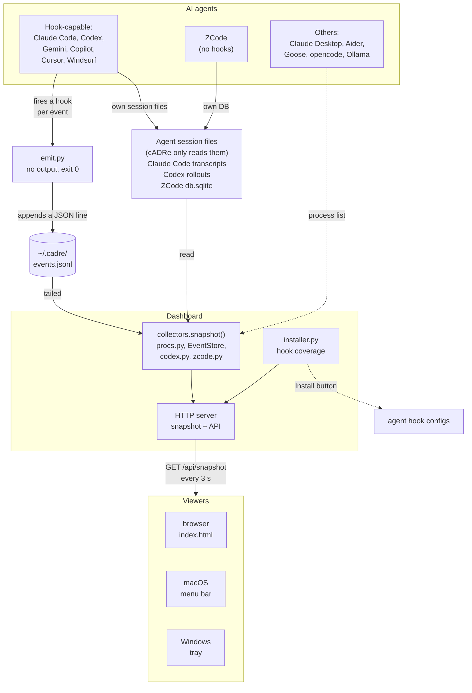
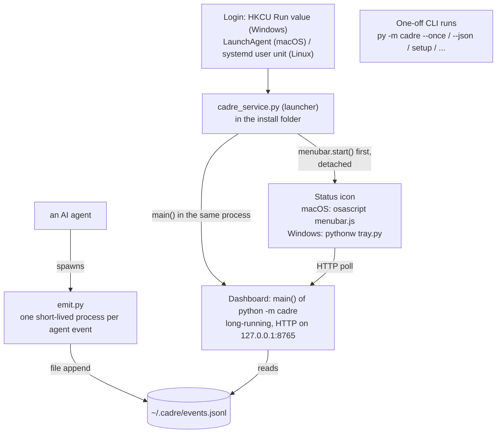

# cADRe architecture

How cADRe is put together: which file does what, how data flows from an AI agent to the
dashboard, where everything lives on disk on Windows and macOS, and what is (and isn't)
written where.

Diagrams are [Mermaid](https://mermaid.js.org/) code blocks; they render on GitHub and
Gitea/Forgejo, and in VS Code's Markdown preview only with the "Markdown Preview Mermaid
Support" extension. Elsewhere they show as text. Everything here was written from the code as of 2026-11-09
(commit `1e936a9` plus the Windows test fixes); when the code changes, update the page that
describes it.

| Page | What it covers |
|---|---|
| [01 · Setup and install](01-setup-and-install.md) | `cadre setup` / `uninstall` / `start`, the install folder, the launcher, autostart per OS |
| [02 · Hooks](02-hooks.md) | How hook entries are discovered, built and written into each agent's config; what `emit.py` does when an agent fires one |
| [03 · Data and logs](03-data-and-logs.md) | `~/.cadre` (event log format, rotation, `paused`, `dashboard.log`, `tray.log`), backups, and every agent file cADRe reads |
| [04 · Backend](04-backend.md) | The snapshot pipeline: processes, transcripts, session DBs, hook overlay, status, flags |
| [05 · Server and API](05-server-api.md) | The HTTP server, every endpoint, request/response shapes, the security checks |
| [06 · Frontend](06-frontend.md) | The dashboard page, the office scene, the macOS menu bar icon and the Windows tray icon |
| [07 · Build, tooling and tests](07-build-and-tooling.md) | No build step; icon generation, the Windows release, test suite |
| [08 · Paths reference](08-paths.md) | Every path cADRe uses or touches, side by side for Windows, macOS and Linux |
| [09 · Detection](09-detection.md) | `cadre/detect`: the rule engine, rule categories, how findings reach the feed, cards and the police droid |
| [10 · Response](10-response.md) | `cadre/respond`: alerts for new findings, Pause / Resume / Kill from the dashboard, false positives, the response log |

## The one-minute version

cADRe is a **read-only observer**. It never controls an agent. Two independent streams of
information meet in one Python process, the dashboard:

1. **Polling** (always on, needs nothing installed): every snapshot lists the machine's
   processes, matches them against a catalogue of known agents, and reads the agents' own
   session files (Claude Code transcripts, Codex rollouts, ZCode's SQLite DB) read-only.
2. **Hooks** (optional, installed by `setup` / `--install-hooks`): each agent that supports
   hooks runs `emit.py` on its lifecycle events; `emit.py` appends a one-line JSON summary to
   `~/.cadre/events.jsonl`. The dashboard tails that file. Hook events are more precise than
   polling ("waiting for you", "running tool X") and win when both are present.

The dashboard merges both into a **snapshot** (one JSON document) and serves it on
`http://127.0.0.1:8765/api/snapshot`. The web page, the macOS menu bar icon and the Windows
tray icon all poll that one endpoint every 3 s.

## System overview

## Component map

Every source file in the repo and its single job.

### `cadre/` (the package; this is what `setup` copies)

| File | Role | Key entry points |
|---|---|---|
| `__main__.py` | CLI and HTTP server. Parses `python -m cadre [setup\|uninstall\|start\|menubar\|tray] [--once\|--json\|--install-hooks …]`, serves the dashboard and the API | `main()`, `serve()`, `Cache`, `event_history()`, `install_hooks()`, `set_paused()`, `host_ok()` |
| `collectors.py` | **The backend brain.** Builds one snapshot: live agents, status, projects, installed tools, hook coverage, feed; asks `detect` for each record's flags | `snapshot()`, `match_spec()`, `read_claude_session()`, `apply_hook()`, `classify()`, `hook_coverage()` |
| `registry.py` | Catalogue of known agents (`AgentSpec`): process-name regexes, binaries, app folders, config dirs | `AGENTS`, `expand()` |
| `procs.py` | Cross-platform process access: list, cwd, environment. Backends: psutil → `ps`+`lsof` (macOS) / `ps`+`/proc` (Linux) / PowerShell CIM (Windows) | `list_processes()`, `fill_details()`, `proc_cwds()`, `proc_env()`, `backend()` |
| `events.py` | The event log: append, tail into memory, page through history, filter | `EventStore` (`STORE`), `append()`, `history()`, `matcher()`, `clean()` |
| `codex.py` | Read-only reader for Codex rollout files | `session_files()`, `read_session()`, `find_live_session()`, `turn_running()` |
| `zcode.py` | Read-only reader for ZCode's SQLite DB (`mode=ro`) | `read_sessions()`, `read_events()` |
| `installer.py` | **Hook installer.** Finds every agent hook file, builds cADRe's hook entries per agent format, writes them safely, reports coverage | `discover()`, `FORMATS`, `command()`, `apply()`, `check()`, `scan()`, `install_paths()`, `run()` |
| `hooks/emit.py` | **The hook itself.** Runs inside each agent event; maps the payload to a short cADRe event and appends it to the log | `build()`, `append()`, `main()` |
| `service.py` | **Setup.** `cadre setup` / `uninstall` / `start`: copy to the install folder, write the launcher, install hooks, autostart, start/stop | `setup()`, `uninstall()`, `start_all()`, `copy_app()`, `add_autostart()`, `LAUNCHER_CODE` |
| `paths.py` | Where the install folder is on each OS; whether this copy is the installed one | `APP`, `LAUNCHER`, `APP_EMIT`, `installed()`, `running_from_install()` |
| `menubar.py` | Starts/stops the status icon on either OS (`cadre menubar` / `cadre tray`) | `start()`, `stop()`, `running()`, `quit_running()` |
| `menubar.js` | macOS menu bar icon: JavaScript for Automation run by `/usr/bin/osascript`, real AppKit `NSStatusItem` | (script) |
| `tray.py` | Windows tray icon: ctypes `Shell_NotifyIconW`, hidden window, popup menu | `Tray`, `main()`, `post()` |
| `static/index.html` | The whole dashboard page (HTML, CSS, JS inline) | `tick()`, `render()`, `window.cadre` helpers |
| `static/office.js` | The animated office scene (robots at desks), DOM-based | `window.officeUpdate`, `window.officeFocus` |
| `detect/__init__.py` | **Detection** public API; importing it registers every rule (see [09](09-detection.md), `detect/README.md`) | `RULES`, `check_event()`, `review_event()`, `review_record()` |
| `detect/engine.py` | `Rule`, the registry and its decorators, running rules safely | `event_rule`, `session_rule`, `record_rule`, `check_*()` |
| `detect/helpers.py` | Shared by rules: command/path of an event, heredoc stripping, path tests, regex tables | `command_of()`, `strip_heredocs()`, `under()`, `command_patterns()` |
| `detect/review.py` | Where detection meets the rest: findings on events and on agent records | `review_event()`, `review_record()`, `alerting()` |
| `detect/rules/*.py` | The rules, one file per category: `commands`, `scope`, `secrets`, `runaway`, `process` | `TABLE`, decorated functions |
| `respond/__init__.py` | **Response** public API (see [10](10-response.md), `respond/README.md`) | `ALERTS`, `act()`, `paused_by_us()`, `audit` |
| `respond/alerts.py` | Which findings are new; pure | `AlertLog.update()` |
| `respond/actions.py` | Pause / resume / kill one agent and its children, after checking the process again | `act()`, `ACTIONS`, `Refused` |
| `respond/audit.py` | The response log `~/.cadre/responses.jsonl` | `append()`, `entries()` |
| `respond/dismiss.py` | False positives: the marks (`~/.cadre/dismissed.json`), hiding marked findings on records and events | `mark()`, `active()`, `apply_record()`, `apply_event()` |
| `static/*.png, *.svg, *.ico, manifest.webmanifest` | Icons (drawn by `scripts/make_icons.py`) and the PWA manifest | |

### Outside the package

| File | Role |
|---|---|
| `scripts/make_icons.py` | Redraws every icon (SVG, PNG, ICO) from one geometry, stdlib only |
| `scripts/build_release.py` | Builds the Windows release: embeddable Python + psutil + package, smoke test, zip, Inno Setup installer |
| `packaging/windows/` | `cadre.iss` (Inno Setup script), `cadre_release.py` (installer → `setup` bridge), `python-embed.sha256` (checked hashes) |
| `tests/` | stdlib `unittest` suite (109 tests; `test_detect.py` runs every rule's own examples, `test_log_race.py` hammers the event log) |
| `docs/` | README-level docs: RUNBOOK, PLAN, and this folder |

## Process model

At most four kinds of cADRe process exist on a machine:

* The dashboard and the icon are independent: either can be stopped without the other.
* Hooks never talk to the dashboard (unless `CADRE_URL` is set); they only append to a file,
  so events are kept while the dashboard is down and the dashboard picks them up on start.

## Design rules that shape everything

These are enforced by the code layout:

* **Read-only towards agents.** Agent data is only read (SQLite with `mode=ro`, JSONL files
  tail-read). The only agent-owned files cADRe ever writes are hook configs, and only when the
  user asks (CLI flags or the dashboard's Install buttons).
* **Hooks never disturb an agent.** `emit.py` prints nothing, always exits 0, uses only the
  standard library (`python -I -S`), and records short summaries, never file contents or
  tool output. Only observe-only events are hooked, never permission or "before" hooks that
  could block.
* **Stdlib first.** No dependency is required; psutil is used when present.
* **Loopback only.** The server binds to 127.0.0.1, rejects non-loopback `Host` headers
  (DNS rebinding) and only accepts `application/json` POSTs (no cross-site form posts).
* **One code path per OS concern.** Processes only through `procs.py`, paths through
  `registry.expand()`, files opened as UTF-8.
